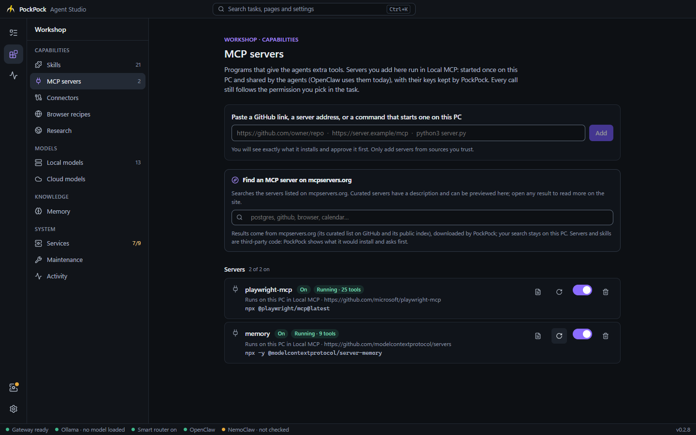

PockPock Agent 0.2.9 adds OpenAI and Claude as cloud model services (replacing OpenRouter), cleans up everything that used a cloud service when you disconnect it, fixes connecting NVIDIA NIM with a valid key, and adds **Local MCP**: PockPock now runs the MCP servers you add, once, for the agents, and keeps their keys.

## Download

| Your computer | Download |
|---|---|
| Windows 10 or 11 (64-bit) | [PockPock-Agent-Setup.exe](https://github.com/PockPock9/PockPockAgent/releases/latest/download/PockPock-Agent-Setup.exe) |
| Mac with Apple silicon (M1 or newer) | [PockPock-Agent-mac-arm64.dmg](https://github.com/PockPock9/PockPockAgent/releases/latest/download/PockPock-Agent-mac-arm64.dmg) |
| Mac with an Intel processor | [PockPock-Agent-mac-x64.dmg](https://github.com/PockPock9/PockPockAgent/releases/latest/download/PockPock-Agent-mac-x64.dmg) |

**Already using 0.2.8 on Windows?** PockPock updates itself: press **Restart to update** when it appears, or check in **Settings → Updates**. On a Mac, download and install it once, the same way as the first time. Your chats, settings and models are kept.

**New to PockPock?** Open the downloaded file, then press **Set up PockPock**; setup installs everything else. Windows may show **"Windows protected your PC"** because PockPock is not code-signed yet: press **More info**, then **Run anyway**. On a Mac, see the [installation guide](https://github.com/PockPock9/PockPockAgent/wiki/Installation).

## What's new since 0.2.8

### OpenAI and Claude cloud models (OpenRouter removed)

- **Workshop → Cloud models** now offers **NVIDIA NIM**, **OpenAI**, **Claude (Anthropic)** and **Alibaba Cloud Model Studio**. OpenRouter is no longer offered.
- **OpenAI** and **Claude** need an API key from their developer platforms (platform.openai.com, platform.claude.com), billed per use. A ChatGPT or Claude.ai subscription is a separate account and does not include API use; the page says so.
- On first connect, current models are switched on: Claude Opus 5.5, Sonnet 5.5 and Haiku 5.5; GPT-5.1, GPT-5 and GPT-5 mini (or the newest GPT models your account offers). Only chat models are listed.
- PockPock adjusts each request to what the service accepts (for example, current Claude models refuse a custom temperature), for Chat, PockPock Agent, OpenClaw and NemoClaw alike.
- A saved OpenRouter key is deleted from your PC when 0.2.9 starts, and model choices that pointed at an OpenRouter model go back to their defaults.

### Disconnecting a cloud service cleans up

When you disconnect a service, or untick one of its models, nothing is left pointing at a model that is gone:

- the chat model, OpenClaw's model and the **Plan in steps** planner go back to their defaults;
- OpenClaw's list of cloud models is rewritten;
- NemoClaw's sandbox goes back to its local model if it was using one of them.

### NVIDIA NIM connects with a valid key

- A valid NVIDIA key could fail with "NVIDIA NIM could not be reached (it did not answer in time)", because the key check waited on a listed model that never answers. The key is now checked against several models at once, and the first clear answer decides: a real key connected in under a second.
- The models switched on when you connect are ones that answered in tests.

### Local MCP

- MCP servers you add now run in **Local MCP**, a new service on the **Services** page. Each server starts the first time an agent uses it and is shared by the agents; one that crashes is started again. OpenClaw uses them today; PockPock Agent and NemoClaw are next.
- Their keys are kept by PockPock (encrypted on Windows) instead of in OpenClaw's configuration.
- **Workshop → MCP servers** shows each server's state (**Running · 25 tools**, **Starts when used**, **Error** with the reason), with **Log** and **Restart** buttons.
- MCP servers you added in earlier versions move into Local MCP automatically when PockPock starts, with their keys and on/off switch. Servers added outside PockPock, and servers using the older SSE transport, stay with OpenClaw.

## Good to know

- Every pull request in this release passed the full check suite (backend tests and desktop typecheck and build on Ubuntu, Windows and macOS).
- Not tested yet with real keys: connecting and chatting with OpenAI or Claude (made-up keys were refused by both real services, and requests were tested against stand-ins built from their documentation). Not tested yet: a full OpenClaw chat that calls a tool through Local MCP (OpenClaw's own MCP client was tested against it).
- Help, screenshots and example prompts are in the [wiki](https://github.com/PockPock9/PockPockAgent/wiki).
- Please [report problems](https://github.com/PockPock9/PockPockAgent/issues/new/choose).
