<p align="center"></p>

# PockPock Agent

[](https://github.com/PockPock9/PockPockAgent/actions/workflows/ci.yml)
[](LICENSE)

PockPock is a local AI workspace for Windows and macOS. Its desktop app, **PockPock Agent**, chats with models running on your own PC and runs agents that plan and carry out tasks: reading and writing files, researching public websites, driving a browser, and, with the OpenClaw engine, operating the PC itself. Everything runs locally through [Ollama](https://ollama.com); prompts and replies are not sent to a cloud service or written to telemetry.

**[Download PockPock Agent](https://github.com/PockPock9/PockPockAgent/releases/latest)** for Windows or Mac, open it, and press **Set up PockPock**. Setup installs everything else. See [Install](#install).

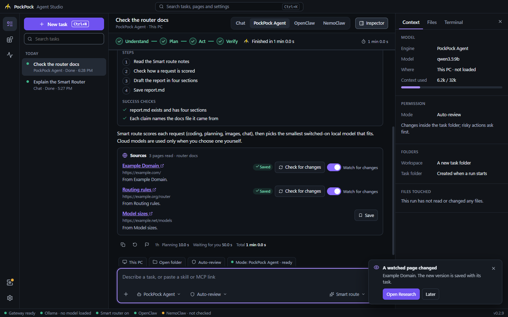

---

## Highlights

**Four ways to work, one window.** Chat with the best local model for each message, or hand a task to an agent: **PockPock Agent** (plans first, works in a task folder), **OpenClaw** (works directly on your computer) or **NemoClaw** (OpenClaw inside a sandbox).

**You approve the plan before anything runs.** PockPock Agent writes a plan with steps, success checks and the files it will deliver, and a reviewer checks it. You can approve it, edit it, or decline it.

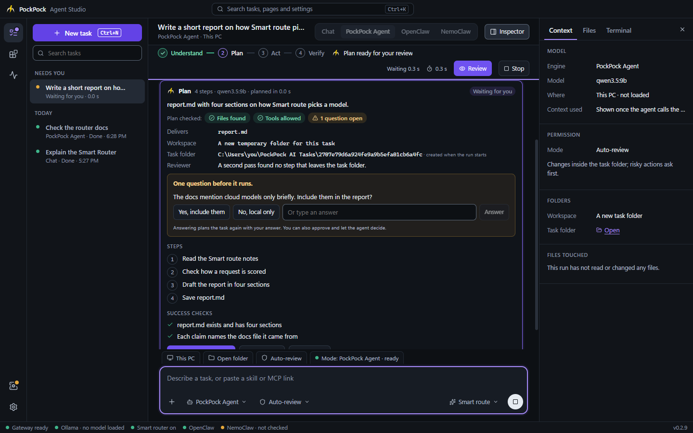

**Every change shows exactly what it does.** File changes come with their diff, commands with the exact command line. You allow them once or deny them, or pick a permission mode that allows them without asking.

| PockPock Agent: review a file change | OpenClaw: approve a command |
|---|---|
| 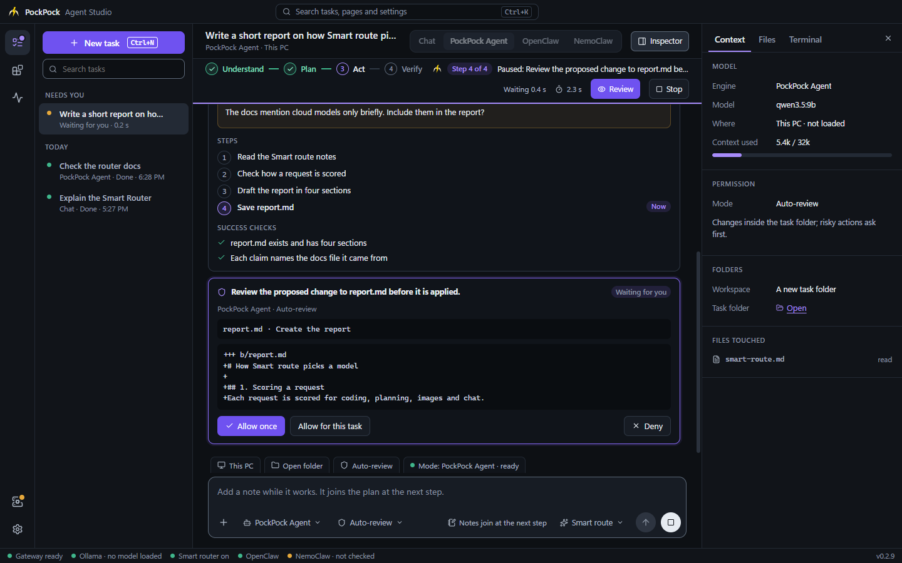 | 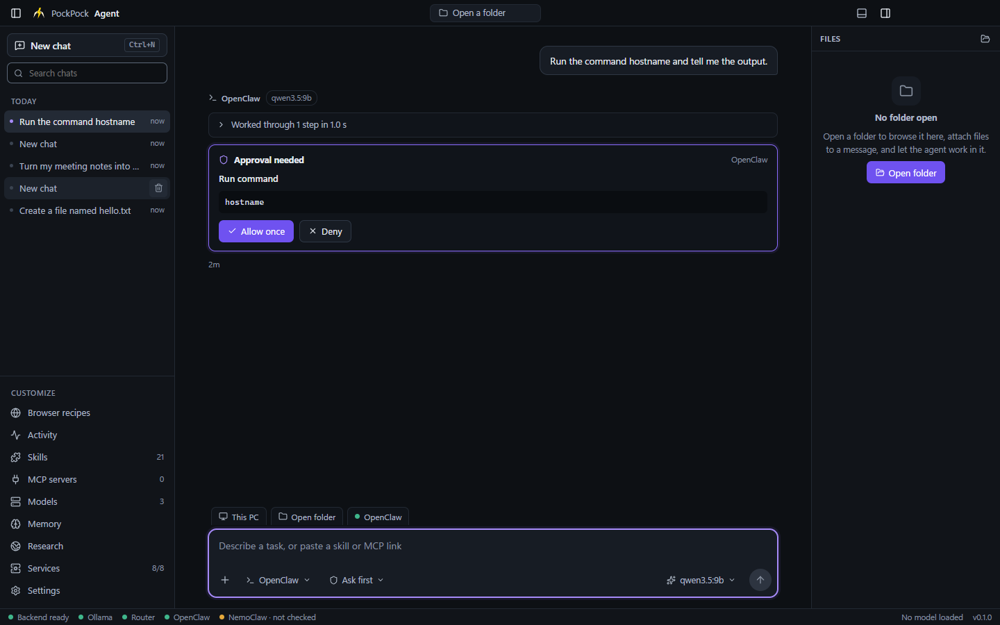 |

**The agent checks its own work.** Before reporting a task done, the agent validates the result against the plan's success checks and lists every file it changed or produced. Under every reply you see where the time went: planning, waiting for you, and working.

**You can always see it working.** While an agent thinks, plans or runs a tool, the bolt of the PockPock mark pulses next to what it is doing, with a running timer, and a thin bar sweeps across the composer. It never just sits there.

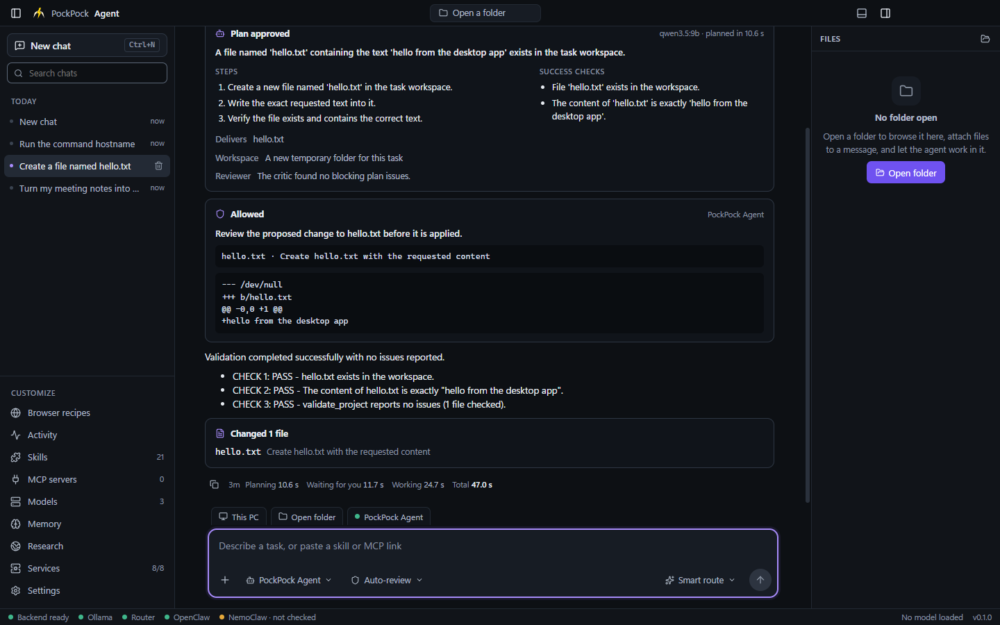

**Skills and MCP servers from a link.** Paste a GitHub skill link or an MCP server address. PockPock shows what it would install, adds it only after you approve, and lets you switch each one off without removing it.

**Five themes.** **PockPock Dark** (the default), **Volt** and **Storm** in the brand's colours, **Feather** for light mode, and **System**, which follows your computer. Every theme meets WCAG AA contrast. Pick one in **Settings → Theme**.

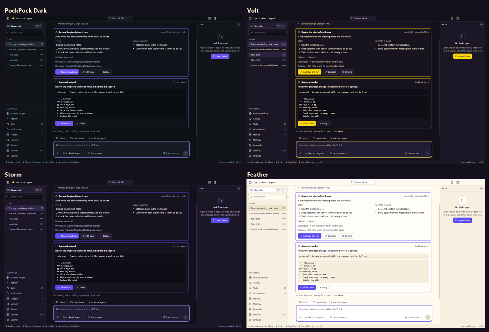

**One app runs everything.** Ollama, the backend services and the agent engines start with the app. Start, stop, restart, or read the logs of each one from the **Services** page.

| Skills | Services |
|---|---|
| 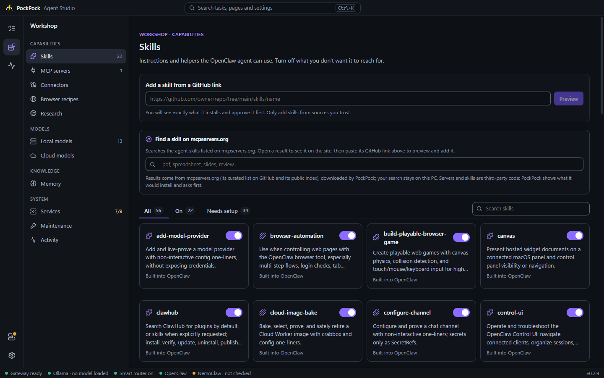 | 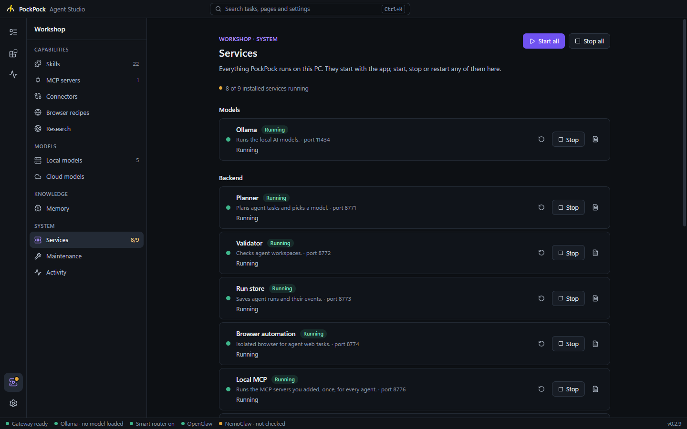 |

**Setup installs everything, then proves it works.** One setup screen installs Python, Ollama and the models, OpenClaw and NemoClaw. It then starts every service, checks each one, and asks a model for a test reply.

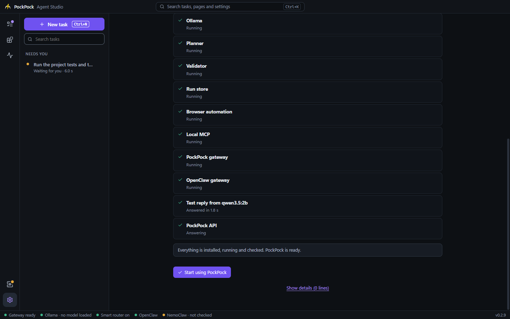

**PockPock can fix itself from your reports.** Press **Report** under a reply that hung, failed or was wrong. The **Maintenance Manager** works through the reports in its own copy of the code: it finds the cause, fixes it with a documentation update, runs the checks and shows you the change. A draft pull request is opened only after you approve it. Choose who does the fixing: PockPock itself with a local model, Claude Code or GitHub Copilot; the app installs and signs in to the last two for you.

| Report a reply | Choose who fixes it |
|---|---|
| 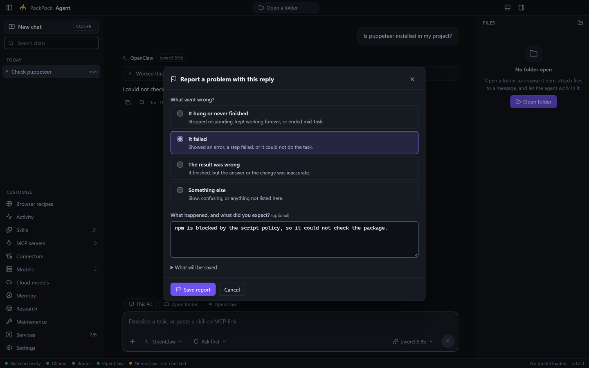 | 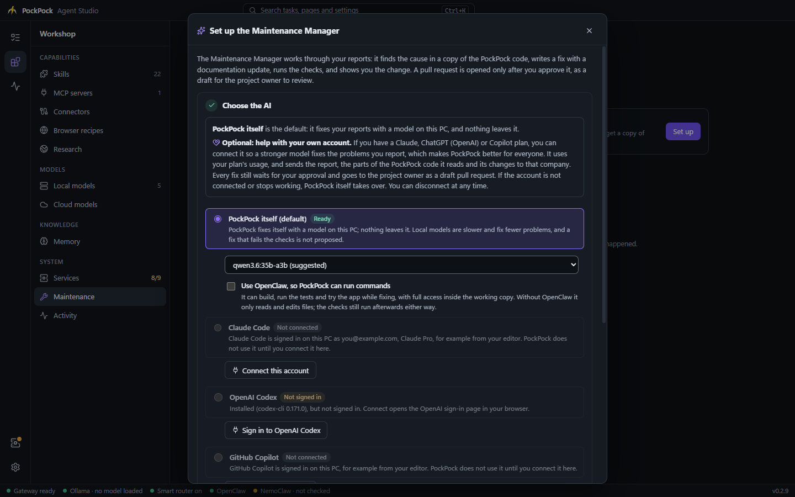 |

**Connect your apps.** The **Connectors** page links GitHub, email, Telegram, Slack, Discord and Notion. You paste a key you create in the app; PockPock checks it with the app, stores it encrypted, and gives the OpenClaw agent tools for it. Sending, posting and creating ask you first.

| Connectors | A connector's page |
|---|---|
| 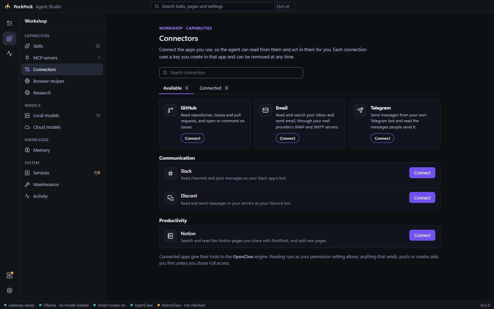 | 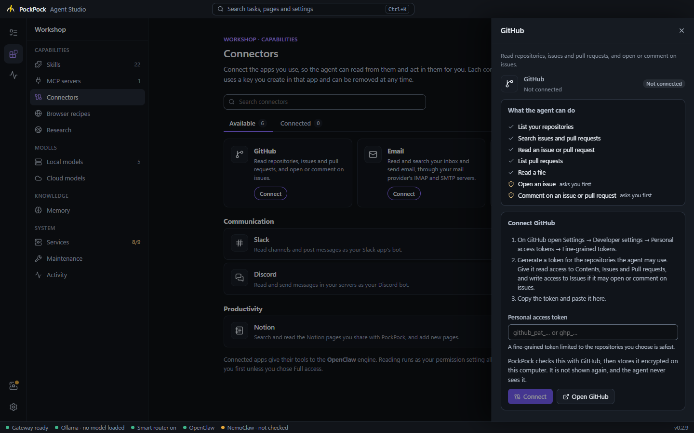 |

**Use cloud models when you want them.** Connect NVIDIA NIM, OpenRouter or Alibaba Cloud Model Studio with your own key, and their models appear in the model menus of every engine. They are used only when you pick one.

| Cloud models | In the model menu |
|---|---|
| 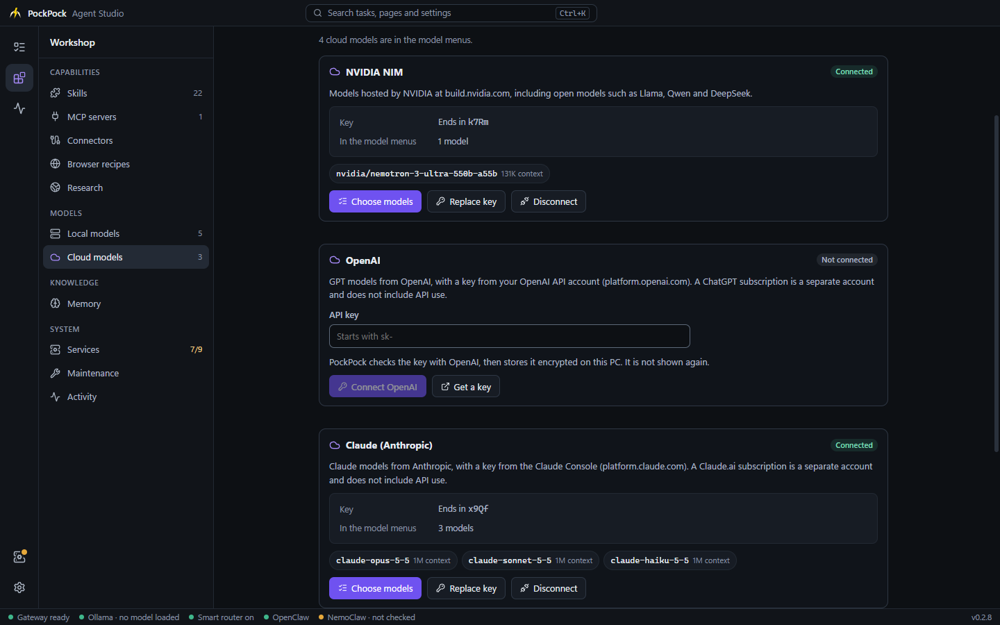 | 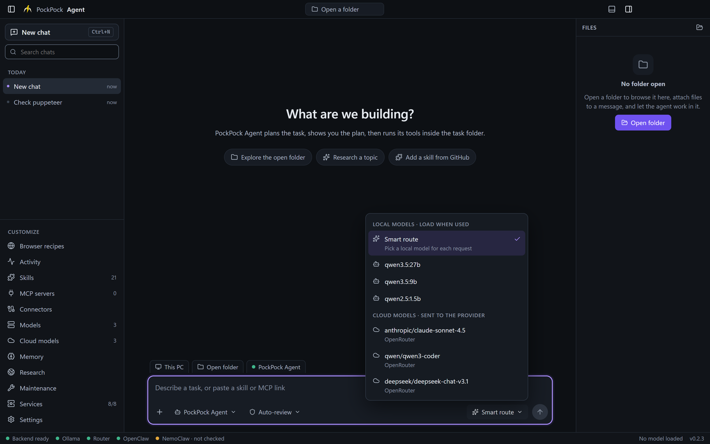 |

*The Cloud models screenshots show sample models and a sample key ending; no real account is connected in them.*

More screenshots, a guide to every feature, and [example prompts for OpenClaw](https://github.com/PockPock9/PockPockAgent/wiki/OpenClaw-Examples) are in the [wiki](https://github.com/PockPock9/PockPockAgent/wiki).

---

## Install

PockPock runs on **Windows 10/11 (64-bit)** and **macOS 12 or later** (Apple silicon or Intel).

**Download:** [Windows](https://github.com/PockPock9/PockPockAgent/releases/latest/download/PockPock-Agent-Setup.exe) · [Mac with Apple silicon](https://github.com/PockPock9/PockPockAgent/releases/latest/download/PockPock-Agent-mac-arm64.dmg) · [Mac with Intel](https://github.com/PockPock9/PockPockAgent/releases/latest/download/PockPock-Agent-mac-x64.dmg) · [all releases](https://github.com/PockPock9/PockPockAgent/releases)

1. Install the app:
   - **Windows:** open `PockPock-Agent-Setup.exe`. PockPock is not code-signed yet, so Windows may show **"Windows protected your PC"**: press **More info**, then **Run anyway**. The installer needs no administrator rights; it installs for the current user, creates Desktop and Start-menu shortcuts, and opens the app.
   - **Mac:** `PockPock-Agent-<version>-mac-arm64.dmg` (Apple silicon: M1 or newer) or `...-mac-x64.dmg` (Intel). Open it and drag **PockPock Agent** to **Applications**. The app is not notarized by Apple yet, so the first time: open it, press **Done** when macOS says it cannot verify the developer, then go to **System Settings → Privacy & Security**, press **Open Anyway** next to PockPock Agent, and confirm. Later launches open normally.
2. The app opens on **Setup**. Press **Set up PockPock**. Setup checks the computer, picks an AI model that runs well on it (`qwen3.5:9b` with a graphics card of 8 GB or more or an Apple silicon Mac with 16 GB, otherwise the smaller `qwen3.5:4b`), checks there is enough free disk space, and installs everything in one go. Nothing needs to be installed beforehand. **Customize** lets you choose the components and the model yourself:

| Component | What it adds | Download |
|---|---|---|
| PockPock backend (always) | Python 3.12 (Windows: from python.org or winget; Mac: through uv, into PockPock's own folder), the PockPock services, an isolated browser for agent web tasks | about 600–700 MB |
| Ollama and models | Ollama plus the AI model (`qwen3.5:4b`, `qwen3.5:9b` or `qwen3.5:27b`) and `qwen3.5:2b` (Smart Router classifier) | about 7 GB with `4b`, 10 GB with `9b` |
| OpenClaw engine | Node.js (if needed), OpenClaw, the PockPock permission plugin, and a list of OpenClaw skills you can untick | about 400 MB |
| NemoClaw engine (only with **Customize**) | Windows: WSL with Ubuntu, Docker Desktop and a NemoClaw sandbox. Mac (Apple silicon only): Apple's Command Line Tools, Docker Desktop and a NemoClaw sandbox | about 8 GB |

3. When the installs finish, setup **starts every service and checks it**: each service must answer its health check, Ollama must produce a short test reply, and the PockPock API must respond. Only then does it say "PockPock is ready". If a check fails, setup names the service; open **Services** to read its log and press **Try again**.

Setup skips anything already installed, so running it again repairs a broken install. What it may ask you for:

- **Windows:** NemoClaw needs administrator approval, may need a Windows restart, and asks you to create an Ubuntu username once.
- **Mac:** nothing for the backend, Ollama or OpenClaw (they install into your user folders without a password). NemoClaw asks for your password once (to install Docker Desktop) and may ask you to install Apple's Command Line Tools.

Setup resumes where it stopped when you reopen the app or press **Continue setup**.

**Requirements:** 16 GB RAM (32 GB recommended) and 20 GB free disk space (30 GB with NemoClaw). For speed: on Windows an NVIDIA GPU with 8 GB or more of video memory (CPU-only works but is slow); on a Mac, Apple silicon (Intel Macs run models on the CPU, slowly). NemoClaw on a Mac needs Apple silicon; NVIDIA lists macOS support as "tested with limitations". An internet connection is needed during setup only.

---

## Using PockPock Agent

The window (**Agent Studio**) has an icon rail on the far left (Tasks, Workshop, Activity, Services, Settings), the task list or Workshop pages beside it, the task in the middle with a **run bar** above it, and an **Inspector** on the right. A status bar along the bottom shows the gateway, Ollama, the Smart Router and the engines.

- **Tasks** are listed by **Needs you** (a plan or approval is waiting), **Running**, **Today** and **Earlier**. **Ctrl+N** starts one; they are saved on this PC. **Ctrl+K** finds any task, page, setting or theme.
- **The run bar** shows the phase (Understand, Plan, Act, Verify), what is happening now, **Signal** (time since the run last sent anything) and the elapsed time. With PockPock Agent it shows **Step 3 of 5** when the agent reports which plan step it is on. After 10 s without anything new it says so and offers **Keep waiting**, **Use *a smaller model*** or **Stop**; a failed run says what was kept and offers **Retry**, **Open Services** and **Report**.
- **The Inspector** (**Ctrl+Shift+E**) shows the model, the context used, the permission and the files the task read, changed or created; its **Files** and **Terminal** tabs show the open folder and open the terminal.
- **The composer** has an engine picker:
  - **Chat** answers directly with the best local model.
  - **PockPock Agent** proposes a plan, checked first against the folder and the permission (files found, tools allowed, anything unclear). Answer its question with one click, edit, reorder or add steps, then **Approve and run** or **Decline**. It works in a task folder (the open folder, or a new temporary one) and shows each step, changed files, sources it read, and files it produced. While it works, the composer takes a **note** that the agent reads at its next step. A failed run can **Retry from step N**. **Plan in steps** (the model menu's Planning section) lets a stronger model, such as a connected NVIDIA NIM model, write a checked step plan that a local model carries out one step at a time; see [Plan-and-Sequence](docs/features/plan-and-sequence.md).
  - **OpenClaw** is an agent that runs directly on this PC: commands, files, the browser, mouse and keyboard. Its permission picker sets what it may do without asking: **Ask first**, **Auto-approve safe**, or **Full access**.
  - **NemoClaw** runs OpenClaw inside a sandbox, so it cannot touch this PC.
- **Theme**: **Settings → Theme** switches between **PockPock Dark** (the default), **Volt**, **Storm**, **Feather** (light) and **System** (follows your computer's light or dark mode). Every theme meets WCAG AA contrast. While an agent works, the PockPock mark's bolt pulses next to what it is doing.
- **Approvals** appear as cards in the conversation with **Allow once**, **Allow for this task** (the same kind of action for the rest of the task: any file change, the same browser action, or in OpenClaw the same command or tool) and **Deny**.
- **Report** (the flag under a reply) records a reply that hung, failed or was wrong, with your description. Personal details such as your user folder and email are hidden first, and you see exactly what is saved. Reports stay on your PC; review, change or delete them on the **Maintenance** page.
- **Maintenance Manager** (on the Maintenance page): **PockPock itself** fixes the problems you report with a local model (optionally through OpenClaw so it can run commands, build and test while fixing). If you want to help make PockPock better, you can connect your own **Claude**, **OpenAI (ChatGPT)** or **GitHub Copilot** account so a stronger model fixes them; it uses your plan and sends the report and the code it reads to that company, and nothing is used until you press **Connect** (a Claude Code already signed in on your PC is not used by itself). **Install and connect** installs the tool and opens its sign-in page; **Disconnect** stops using it. When an account is not connected or stops working, PockPock itself takes over. Then connect GitHub and allow a copy of PockPock to be cloned. On a report, **Fix with …** finds the cause, fixes it with a documentation update and runs the checks; or switch on **Keep fixing reports automatically** to let it work through open reports by itself. Each fix waits for your approval, then opens a draft pull request for the project owner to review. See [Problem reports and Maintenance](docs/features/maintenance.md).
- **Timing**: while a reply runs, counters show the seconds spent thinking, planning or on the current step. Afterwards each step shows how long it took, and a line under the reply splits the time into **Thinking** or **Planning**, **Waiting for you** (time on plan and approval cards), **Writing** or **Working**, and **Total**.
- **Files** (Inspector → Files) shows the open folder; attach a file to the next message or open it. **Terminal** (**Ctrl+J**) is PowerShell in that folder, under the composer.
- **Notifications** appear bottom right: an update that is ready (**Restart to update**), the gateway stopped or Ollama not running (**Open Services**), and a watched page that changed (**Open Research**).
- **Skills and MCP servers**: paste a GitHub link in the composer or on the **Skills** / **MCP servers** page, or search **mcpservers.org** on those pages: curated servers can be previewed and installed from the results, and every result opens on mcpservers.org. You see what would be installed and approve it first. Switch any of them off without removing it.
- **Browser recipes** saves web tasks you repeat; each step asks for approval when it runs.
- **Activity** shows which model handled each request and how long it took (no prompt text is stored).
- **Models**, **Memory** and **Research** control which local models are used, learned preferences, and whether agents may read public websites. **Research** also lists the pages you chose to watch: turn on **Watch for changes** on a saved source and PockPock re-reads that page in the background (every 6 hours while it runs, only while reading public websites is allowed) and tells you when it changes. Watching is off unless you turn it on for a page.
- **Connectors**: connect **GitHub**, **email**, **Telegram**, **Slack**, **Discord** or **Notion** with a key you create in that app. PockPock checks the key with the app, stores it encrypted, and gives the OpenClaw agent tools for it (read issues, search mail, read messages; sending, posting and creating ask you first). See [Connectors](docs/features/connectors.md).
- **Cloud models**: connect **NVIDIA NIM**, **OpenRouter** or **Alibaba Cloud Model Studio** with your own API key, choose which of their models you want, and pick them in the model menu of Chat, PockPock Agent, OpenClaw or NemoClaw. A cloud model is used only when you pick it; **Smart route** keeps choosing local models. A chat that uses a cloud model sends its messages, files and tool results to that service. See [Cloud models](docs/features/cloud-models.md).
- **Updates** (Windows): new versions download in the background and install when you press **Restart to update** or quit PockPock; your chats and settings are kept. On a Mac, PockPock tells you when a new version is available and links to its download.
- **Services** starts, stops and restarts everything (Ollama, the backend services, OpenClaw, NemoClaw) all at once or one by one, shows their logs, and sets startup options. All services start when the app opens; a model loads into memory only when a message uses it.

Full guide: [PockPock Agent desktop app](docs/features/desktop-app.md).

---

## How it works

PockPock Agent is an Electron app that talks to a local API (the **gateway**, `127.0.0.1:8766`) backed by small services on loopback ports:

| Service | Port | Role |
|---|---|---|
| Gateway | 8766 | Chat, Smart Router, agent runs, approvals, files, skills and MCP |
| Planner | 8771 | Plans agent tasks, critic review, model choice |
| Validator | 8772 | Checks agent workspaces before a task is reported done |
| Run store | 8773 | Saves agent runs and their events |
| Browser automation | 8774 | Isolated Chromium for agent web tasks and browser recipes |
| Ollama | 11434 | Runs the models |
| OpenClaw gateway | 18810 | The OpenClaw engine (optional) |
| NemoClaw sandbox | 18789 | The NemoClaw engine in WSL (optional) |

### Smart Router

Chat and PockPock Agent requests go through the Smart Router, which picks a model for each request from the models switched on in **Models**:

1. A fast heuristic recognises code, math, and images.
2. For anything else, `qwen3.5:2b` classifies the intent, complexity (1–10) and confidence using the recent conversation.
3. Generation settings (temperature, top-p) and a role-specific system prompt are set for the task.
4. If the chosen model fails, the router falls back to another one without losing the conversation. If the small triage model is not installed, simple turns fall back to the general model instead of failing.

Typical roles on the reference PC (any installed models can be used):

| Role | Model | Used for |
|---|---|---|
| Router | `qwen3.5:2b` | Classifies every request |
| Quick / triage | `qwen3.5:2b` | Greetings, short factual questions, and other simple turns |
| General / default | `qwen3.5:9b` (or `qwen3.5:4b`, the model Setup installs) | Everyday questions and agent work. The router's built-in general model is `qwen2.5:14b`; when it is not installed, PockPock uses the first enabled model other than the router's |
| Accurate, slow | `qwen3.5:27b` | Complex tasks (pick it in the model picker) |
| Coder | `qwen2.5-coder:7b`, `qwen2.5-coder:14b` | Code and DevOps |
| Reasoner | `deepseek-r1:14b` | Math and step-by-step logic |
| Vision | `llava:7b` | Screenshots and images |
| Tool calling | `mistral-nemo:12b` | Agent tool loops |

### Agent safety

- Agent requests are accepted only from this PC. The desktop app reaches the gateway through its own loopback origin.
- **PockPock Agent** works only on attached files, public websites named in the task (private and local addresses are blocked), and its task folder. It has no general shell. **Default** permission is read-only; **Auto-review** asks before each file change; **Full access** applies changes inside the task folder without asking and allows the project's own build and test scripts.
- **OpenClaw** has no sandbox; its permission mode is enforced by the PockPock permission plugin inside OpenClaw, and unknown tools always ask. **NemoClaw** is confined to its sandbox.
- Skills and MCP servers are third-party content. PockPock shows the source, commit and exact command before installing, but does not review the code.

Details: [Architecture](docs/ARCHITECTURE.md) and the [feature index](docs/FEATURES.md).

---

## For developers

```text
PockPockAgent/
├── desktop/            PockPock Agent (Electron + React + Vite) and its installer
│   ├── electron/       main process: services, setup, local server, files, terminal
│   └── src/            the interface
├── backend/
│   ├── scripts/        gateway (pockpock_server.py), Smart Router, telemetry, pockpock.py, run_tests.py
│   └── projects/       planner, validator, run_store, browser_automation, agent_core, agent_tools,
│                       agent_extensions, connectors, openclaw_bridge, nemoclaw_bridge, model_router, local_memory, observability
├── docs/               architecture, roadmap, task tracker, feature pages
├── design-system/      desktop design tokens and rules
└── AGENTS.md           rules for anyone (human or AI) changing this repository
```

Run from source (Python 3.12 and Node.js 24):

```powershell
# Windows
py -3.12 backend\scripts\pockpock.py setup   # creates .venv, installs packages and Chromium
cd desktop
npm install
npm run build
npm run app                                    # starts the app; it starts the services
```

```bash
# macOS
python3.12 backend/scripts/pockpock.py setup
cd desktop && npm install && npm run build && npm run app
```

`npm run dev` runs the interface with hot reload. Without the desktop app, `py -3.12 backend\scripts\pockpock.py start` runs the backend services in the foreground (Ctrl+C stops them).

Checks:

```powershell
.venv\Scripts\python.exe backend\scripts\run_tests.py   # every backend test suite
cd desktop; npm run typecheck; npm run build
```

Build the installers in `desktop/`:

- `npm run dist:win` (on Windows) writes `release/PockPock-Agent-Setup-<version>.exe`.
- `npm run dist:mac` (on a Mac) writes `release/PockPock-Agent-<version>-mac-arm64.dmg` and `-mac-x64.dmg`, plus `.zip` copies. macOS apps can only be built on a Mac.
- Without a Mac, run the **Desktop installers** workflow (`.github/workflows/desktop-release.yml`) from the GitHub Actions tab, or push a tag such as `v0.2.0`; it builds both installers on GitHub's Windows and macOS machines and attaches them to the run.

Neither installer is code-signed. Windows SmartScreen warns on first run; the Mac app is signed ad hoc (so it runs on Apple silicon) but not notarized, so the first launch needs **Open Anyway** (see Install). Signing with an Apple Developer ID and a Windows code-signing certificate removes both warnings.

Other tools can use the models directly through Ollama's OpenAI-compatible endpoint, `http://localhost:11434/v1` (Cursor, VS Code Continue, LangChain, n8n and others).

Planned work is in the [roadmap](docs/ROADMAP.md) and the [task tracker](docs/TASKS.md). Read [AGENTS.md](AGENTS.md) before contributing.

---

## Data and privacy

| What | Where |
|---|---|
| Desktop chats and settings | `%APPDATA%\PockPock Agent` |
| Backend data (runs, telemetry without prompts, recipes, memory) and service logs | `%LOCALAPPDATA%\PockPock` and `%LOCALAPPDATA%\LocalAIObservability` |
| Installed Python environment (installer only) | `%LOCALAPPDATA%\PockPock\runtime` |
| Agent task folders | `%USERPROFILE%\PockPock AI Tasks` |
| Models | `%USERPROFILE%\.ollama` |
| OpenClaw config, skills and MCP servers | `%USERPROFILE%\.openclaw` |
| Cloud API keys (encrypted by Windows or the macOS Keychain) and chosen cloud models | `%APPDATA%\PockPock Agent\cloud.json` |
| Connector keys (encrypted the same way) | `%APPDATA%\PockPock Agent\connectors.json` |

Uninstalling the app keeps this data; delete the folders to remove it.

## Troubleshooting

| Problem | Fix |
|---|---|
| Status bar says a service is stopped | **Services** → **Start**, or **Start all**. The service's log is one click away. |
| "PockPock is not set up yet" | **Settings** → **Run setup**. |
| Chat or PockPock Agent does not answer | Check **Services** (Ollama and the gateway must run) and that the Smart Router is on in **Settings**. |
| OpenClaw is offline | **Services** → OpenClaw gateway → **Start**. Start it from the app or PowerShell, never from Git Bash. |
| Mac: "PockPock Agent cannot be opened" or "cannot verify the developer" | The app is not notarized yet. **System Settings → Privacy & Security → Open Anyway**, once. |
| Mac: "is damaged and can't be opened" | The download was altered or only partly copied. Download the `.dmg` again and drag the app to Applications. |
| Mac: NemoClaw is not offered | It needs Apple silicon. Intel Macs can use Chat, PockPock Agent and OpenClaw. |
| A large model is very slow | Expected when it does not fit in video memory; use it for hard tasks and start a new chat for it. |

More: [desktop app](docs/features/desktop-app.md), [OpenClaw](docs/features/openclaw-agent.md), [NemoClaw](docs/features/nemoclaw-agent.md), [skills and MCP](docs/features/agent-extensions.md).

---

## Contributing

Contributions are welcome. Read [CONTRIBUTING.md](CONTRIBUTING.md) for the branch strategy (GitHub Flow: short-lived branches, pull requests to `main`, squash merges) and [AGENTS.md](AGENTS.md) for the project rules. Report bugs and request features with the [issue forms](https://github.com/PockPock9/PockPockAgent/issues/new/choose), ask questions in [Discussions](https://github.com/PockPock9/PockPockAgent/discussions), and report security problems privately as described in [SECURITY.md](SECURITY.md). Everyone taking part follows the [Code of Conduct](CODE_OF_CONDUCT.md). User documentation is also in the [wiki](https://github.com/PockPock9/PockPockAgent/wiki).

## License

PockPock Agent is licensed under the [Apache License 2.0](LICENSE). See [NOTICE](NOTICE).
