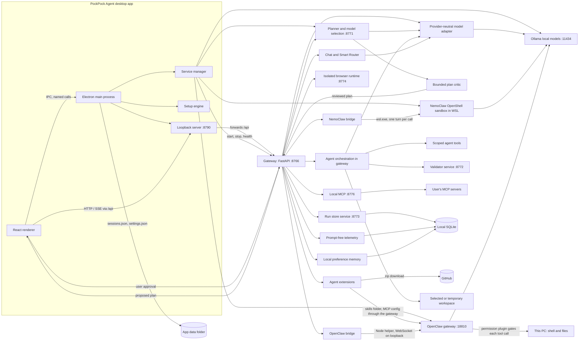

# PockPock AI architecture

This document describes the implemented local multi-process architecture and a staged path to grow it. Workflow stages with clear contracts run as separate loopback services, coordinated by a gateway API for a single-user local deployment. The only client is the PockPock Agent desktop app, which uses the gateway's public API; internal services are not exposed to it.

## Product and runtime boundary

The desktop app's main process serves the built interface and forwards `/api` to the gateway, starts and watches every service, runs first-run setup, and owns chat storage, the inspector's Files tab and the terminal. The gateway owns public APIs, chat, model routing, and HTTP/SSE transport. Agent execution is owned by the in-process `backend/projects/agent_core/` application layer and invoked by the gateway after local request checks. Planning/model selection (including the bounded plan critic), workspace validation, run/event persistence, and isolated browser automation are separate FastAPI processes with explicit HTTP contracts. Planner, critic, agent tool calls, gateway route classification, code-completeness review, and gateway chat streaming use the provider-neutral `backend/projects/model_router/` contract, currently backed only by Ollama. Cloud model providers are not configured. All local services bind to loopback; internal HTTP calls require a per-install token.

## Implemented module ownership

| Module | Responsibility | Boundary |
| --- | --- | --- |
| `desktop/electron/main.cjs`, `preload.cjs` | Window, single instance, IPC surface, login item, quit behaviour | Every IPC handler rejects callers other than the app's own origin; the renderer is sandboxed with no Node.js access |
| `desktop/electron/maintenance.cjs`, `maintenance-connect.cjs`, `maintenance-fix.cjs` | Maintenance Manager | Detects coding AIs, installs and signs in to Claude Code or GitHub Copilot when the user presses Connect, signs in to GitHub through the GitHub CLI, clones or forks the repository after the user allows it, and runs fixes in git worktrees. Pushing and `gh pr create --draft` happen only on the user's approval. See [maintenance](features/maintenance.md) |
| `desktop/electron/reports.cjs` | Problem reports | One redacted JSON file per report under the app data folder; `reports:*` IPC validates ids, categories and sizes. See [maintenance](features/maintenance.md) |
| `desktop/electron/themes.cjs` | Theme ids and the window colours per theme | The window opens in the saved theme and loads the page with `?theme=<id>` (`public/theme-boot.js` applies it before the first paint). `theme:set` (preload `theme.set`) accepts only known ids and sets `nativeTheme.themeSource`, the window background and the Windows caption buttons. The colours themselves live in `src/styles.css`; see [themes](features/themes.md) |
| `desktop/electron/services.cjs`, `platform.cjs`, `paths.cjs` | Start, stop, restart and health-check Ollama, the four backend services, the gateway, the OpenClaw gateway and the NemoClaw sandbox; logs; locating Python, the backend and tools on Windows and macOS; process control per system (taskkill/netstat on Windows, process groups/lsof on macOS); NemoClaw's shell (WSL or bash) and Docker | Services the app started are stopped when it quits (configurable); services already running are adopted. Python services run from the repository `.venv` in development and from `runtime/venv` under the per-user app-data folder when installed. On macOS the app adds its tool folders to PATH, because apps opened from Finder get a minimal PATH |
| `desktop/electron/setup.cjs`, `setup-win.cjs`, `setup-mac.cjs` | First-run and repair setup: Python 3.12 and backend packages, Ollama and default models, Node.js and OpenClaw (onboarding, tuning, permission plugin, skills choice), NemoClaw with its prerequisites, then a final check that starts every service and confirms it answers and that a model replies | Shared steps in `setup.cjs`; installers per system in `setup-win.cjs` (winget, else direct downloads; WSL) and `setup-mac.cjs` (uv, Ollama.app, Node.js archive and Docker Desktop image, all checksum-verified where the publisher provides a checksum). Skips installed components; saves a pending plan so setup resumes after a restart or a user step |
| `desktop/electron/server.cjs` | Serves `desktop/dist` on 127.0.0.1:8790 (or a free port) and forwards `/api/*` to the gateway, streaming unbuffered | Gives the page one loopback origin so the gateway's same-PC check passes; drops forwarding headers |
| `desktop/electron/workspace.cjs`, `terminal.cjs` | Files panel listing/reading confined to the open folder; pseudo-terminal sessions | Paths resolving outside the open folder are refused, including through symlinks and junctions (real paths are checked); terminal runs with the user's permissions |
| `desktop/src/` | React interface (Agent Studio): icon rail, task list, Workshop navigation, run bar, inspector (Context, Files, Terminal), command palette; tasks in the four engines, plan review, approvals, research sources, changed files; the Workshop pages (Skills, MCP servers, Connectors, Browser recipes, Research, Local and Cloud models, Memory, Services, Maintenance, Activity), Setup and Settings | Uses only the gateway HTTP API and the preload bridge. `lib/runState.ts` derives each turn's phase and state (working, slow, waiting, failed, done) from its own events and timing. Each Workshop page is its own module under `pages/`, built from the shared page kit in `components/page.tsx`. See [desktop app](features/desktop-app.md) |
| `backend/scripts/pockpock_server.py` | FastAPI app lifecycle, HTTP routes, local request policy, and chat | Client-facing composition root; agent-run routes pass authenticated requests to the in-process core |
| `backend/scripts/smart_router.py` | The Smart Router: heuristic and classifier-based model choice, generation settings, fallback | Used in-process by the gateway with the shared model provider |
| `backend/scripts/telemetry_store.py` | Prompt-free telemetry storage (routing decisions, call timings, settings) and the summaries in `/api/state` | Prompts and responses must not be added to this store |
| `backend/scripts/pockpock.py`, `pockpock_paths.py`, `run_tests.py` | Developer setup and foreground supervision of the backend without the desktop app; per-user data paths; the backend test runner | Repository-local Python environment and loopback-only services |
| `backend/projects/coding_cli/`, `desktop/electron/cli-command.cjs` | PockPock Code, the `pockpock-code` terminal coding agent: arguments and sessions (`cli.py`), the agent loop with approvals, nudges and context shortening (`agent.py`), the Ollama tool-call client (`llm.py`), tools confined to the project folder (`tools.py`), the system prompt and project overview (`context.py`), terminal output (`ui.py`). The desktop app writes the launcher and adds it to PATH | Runs in the user's terminal, talks only to the local Ollama, and does not use the gateway or the services. Paths outside the project folder are refused; commands are asked about unless the mode is full-auto. See [PockPock Code](features/coding-cli.md) |
| `backend/projects/agent_core/executor.py` | Approved agent-run execution, model/tool coordination, delegation, cancellation, and finalization | In-process application layer with explicit `AgentCoreServices` dependencies; not a separate service process |
| `backend/projects/agent_core/precheck.py` | The fixed plan pre-check shown on the plan card: files the request names, permission and research for the planned capabilities, open questions | Pure function called by the gateway after the planner answers; no model call; warnings never block approval. See [agent runs](features/agent-runs.md) |
| `backend/projects/model_router/` | Provider-neutral chat-completion request contract and provider adapters | Ollama for local models (native JSON/context options and OpenAI-compatible tool calls are mapped by the adapter). `cloud.py` and `cloud_api.py` add cloud providers (NVIDIA NIM, OpenAI, Anthropic Claude, Alibaba Cloud Model Studio): a model named `<provider>/<model>` is routed to its provider with a key the desktop app pushed into memory, and `/cloud/v1` is a local OpenAI-compatible endpoint through which the planner, OpenClaw and NemoClaw reach those models without holding a key. See [Cloud models](features/cloud-models.md) |
| `backend/projects/connectors/` | Connectors: external apps as agent tools | The catalog (GitHub, email, Telegram, Slack, Discord, Notion), each app's credential check and tool calls, the in-memory credentials pushed by the desktop app, and `/mcp/connectors`, an MCP endpoint registered in OpenClaw as `pockpock-connectors`. Only external apps belong here. See [Connectors](features/connectors.md) |
| `desktop/electron/connectors.cjs` | Connectors in the desktop app | Stores connector credentials encrypted with `safeStorage`, has the gateway check them, and pushes the connected apps to the gateway |
| `desktop/electron/cloud.cjs`, `cloud-openclaw.cjs` | Cloud providers in the desktop app | Checks and stores API keys (encrypted with `safeStorage`), lists and saves the chosen models, pushes the configuration to the gateway, and writes the `pockpock-cloud` provider into OpenClaw's configuration |
| `backend/projects/local_memory/` | Allowlisted, automatic local response-preference capture and review/delete storage | Stores only normalized preference values in SQLite; disabled state, individual deletion, and clear-all are user controlled |
| `backend/projects/agent_skills/` | Self-authored skill + reasoning memory: skill library (SKILL.md files on disk), ReasoningBank-style tips and a semantic fact store in SQLite, a distiller (stub + small local model, think:false), and the skill-inbox promotion gate | Local files + SQLite only, no external memory platform; a candidate is retrievable only after passing its verification test or human approval (promoted skills / active tips only, status filtered before ranking); contradictions invalidate, never overwrite; pruning decisions are logged. Retrieval into live runs is behind `POCKPOCK_SKILLS_ENABLED` (default off). See [Self-authored skill + reasoning memory](features/agent-skills-memory.md). |
| `backend/projects/observability/` | Prompt-free trace sink contract and deterministic routing evaluation report | Operational telemetry excludes prompts; synthetic evaluation cases emit only case IDs and aggregate/model-selection outcomes |
| `backend/scripts/research_watch.py` | Watched research sources: which are due, the per-minute background pass started in the gateway's lifespan, interval and on/off settings | Fetches only through the gateway's manual-refresh path, only for sources the user chose to watch and only while research is enabled; owns no storage |
| `backend/scripts/agent_run_store.py` | Run/event schema, durable run lifecycle and cancellation state, event replay, and task journal writing | Persistence boundary used by routes and agent orchestration; owns run-history SQL and legacy-safe cancellation-column migration |
| `backend/projects/run_store/delegation_scheduler.py` | Bounded dependency scheduling and deterministic child-run identity | Scheduler and gateway child execution with scoped context, deadlines, cancellation, and durable typed results |
| `backend/projects/agent_tools/` | Agent tool contracts, shared contexts, registry/dispatch, workspace operations, public research/source and answer contracts, attachments, and artifacts | In-process capability package with focused modules and a stable facade; versioned schemas and runtime metadata validate calls/results before tool execution and model return. Research answers must cite known source IDs and exact retrieved quotes; conflicts require distinct sources. Public fetch tools are gated by a persisted local research-provider setting. `tool_retriever.py` retrieves the top tools per task from the registry (permission/risk filtering before ranking, BM25 + deterministic routing, optional Ollama dense embeddings, plus a `search_tools` escape hatch the executor hydrates mid-task) so the agent sees a one-line tool index plus only the selected full schemas; `context_compaction.py` bounds the loop's message history (truncate, prune, summarise) once it passes 75% of the context window; see [Tool retrieval](features/tool-retrieval.md). |
| `backend/projects/plan_sequence/` | Sequence plan schema/validation, ≤400-token state capsule, code-first done-condition verifier, sequenced runner (one step at a time, `think=False`, harness-enforced pinned tools, retry ≤2× then re-plan of remaining steps), planner/executor model routing | In-process package; the planner service's `POST /plan-sequence` is the only live entry point. No gateway run-sequence route, no in-repo runner caller or real-tool adapter, and runner events are not persisted to the run store yet. See [Plan-and-Sequence](features/plan-and-sequence.md) |
| `backend/projects/planner/app.py`, `critic.py` | Converts a user task into execution steps, selects an enabled tool-capable local model, and reviews the draft plan | Internal `/plan` HTTP API on port 8771; calls the shared model adapter for planning and bounded critique/repair. The user still approves the final plan before execution. |
| `backend/projects/validator/app.py` | Runs deterministic workspace validation | Internal `/validate` HTTP API on port 8772; imports validation implementation from `backend/projects/agent_tools` |
| `backend/projects/run_store/app.py` | Owns agent run/event persistence and cancellation endpoints | Internal run/event HTTP API on port 8773; SQLite remains the local durable store |
| `backend/projects/browser_automation/app.py`, `engines.py`, `recipes.py` | Owns isolated browser runs, browser-engine lifecycle, and browser workflow recipe contracts/persistence | Internal loopback HTTP API on port 8774; Playwright/Chromium default and optional single-context Lightpanda; contexts are ephemeral and recipes use a separate local SQLite database |
| `backend/projects/internal_auth.py` | Authenticates service-to-service requests | Shared loopback service token via `X-PockPock-Internal-Token` |
| `backend/projects/nemoclaw_bridge/` | Sends turns in NemoClaw mode to the NemoClaw sandbox in WSL and returns the reply as chat SSE events | In-process router mounted by the gateway; same-PC requests only; one `wsl.exe` process per turn with user text passed only through environment variables. Setup installs NemoClaw; the bridge only talks to it. See [NemoClaw agent mode](features/nemoclaw-agent.md) |
| `backend/projects/openclaw_bridge/` | Sends turns in OpenClaw mode to the OpenClaw gateway on Windows, relays approval requests and decisions, and ships the permission plugin and the workspace guidance setup installs | In-process router mounted by the gateway; same-PC requests only; one Node helper process per turn speaking the gateway WebSocket protocol on loopback, with the request passed on stdin; per-session mode recorded in `~/.openclaw/pockpock/permissions.json`. See [OpenClaw agent mode](features/openclaw-agent.md) |
| `backend/projects/openclaw_bridge/tool_selection.py` | Per-turn skill and MCP-server selection for the OpenClaw engine (tool retrieval through OpenClaw's session `toolOverrides`) | Only hides; never blocks a turn; uses the extension list as its catalog |
| `backend/projects/mcp_hub/` | Local MCP: runs the MCP servers added in PockPock and serves each at `/mcp/<name>` | Loopback service on port 8776; management routes for the gateway with the internal token, MCP routes with the hub token; definitions and sealed secrets in `<PockPock data>/mcp-hub/servers.json`. See [Local MCP](features/local-mcp.md) |
| `backend/projects/agent_extensions/` | Searches mcpservers.org's curated list and sitemaps (`directory.py`, cached daily or weekly); previews a pasted GitHub or MCP link and, after approval, installs skills into OpenClaw's skills folder or tests an MCP server and saves it in Local MCP (OpenClaw gets its hub address); lists, switches on/off, restarts and removes them; at gateway start moves servers installed earlier into Local MCP | In-process router mounted by the gateway; same-PC requests only; outbound HTTPS to GitHub for previews; a short-lived Node helper for gateway config changes; one test start of an approved MCP server; manifest in `~/.openclaw/pockpock/extensions.json`. See [Agent engines, skills, and MCP servers](features/agent-extensions.md) |

The run store currently uses the same local SQLite database file as telemetry, but separate tables and an HTTP service boundary. `agent_runs` stores task identity and status; `agent_run_events` stores ordered, versioned JSON events for replay. Unversioned legacy payloads remain readable as version 0; new writes use version 1. Task memory is a Markdown projection of those durable events, stored with the task output. Separate preference memory stores only allowlisted, normalized response-style choices; raw prompts are not persisted, and the desktop app's Memory page supports review, disable, and deletion. Chat history is stored by the desktop app in its data folder. Browser automation owns disposable contexts only; it never opens the user's normal browser profile. Recipe definitions and revisions live in a second local SQLite database under `%LOCALAPPDATA%\PockPock`, outside the repository and separate from run history. Recipe inputs store labels and types, not values. See [agent tool and run event contracts](features/agent-tool-contracts.md) and [the isolated browser runtime](features/browser-runtime.md).

The agent tool catalog and implementation live under `backend/projects/agent_tools/`, with focused tests beside the package. `workspace.py`, `research.py`, and `artifacts.py` own their respective implementations; `registry.py` owns model schemas and dispatch; `contracts.py` is the source of truth for registered input/output schemas, permission, side effects, timeouts, and payload bounds. `tool_retriever.py` builds a retrievable index from the registry (never a second copy of the tools) and selects the top tools per task — permission/risk filtering before ranking, deterministic routing for high-confidence intents, BM25, and optional dense embeddings via Ollama, plus a `search_tools` escape hatch the executor hydrates mid-task — so the executor shows the model a one-line index plus only the selected full schemas; `context_compaction.py` bounds the loop's message history (truncate, prune, summarise) once it passes 75% of the context window; see [Tool retrieval](features/tool-retrieval.md). `__init__.py` preserves the public imports while the gateway consumes the package registry/dispatch interface. The gateway owns the local `frog_research_provider` setting and rejects research fetch calls when disabled; the Research page shows the provider's network destination. The browser runtime is a separate loopback service because its browser processes need isolation; `browser_automation/engines.py` owns lifecycle adapters for default Playwright/Chromium and opt-in Lightpanda CDP. Lightpanda is loopback-only, limited to one active run context, and requires private-network blocking on its server; future model-callable browser tools still need typed schemas and registry dispatch in `backend/projects/agent_tools/`.

The Stop control calls `POST /api/runs/{run_id}/cancel`. The gateway asks the run store to durably mark the run `cancelling`, signals an in-process event, and races that signal against active planner/model/tool operations. Model calls and tools are cancelled cooperatively; tool-specific timeouts and a 15-minute total run deadline apply. The gateway also asks the browser runtime to close the run's Chromium context. Auto-review workspace patches are held until the run store resolves an approval bound to the patch diff. Browser actions in Default and Auto-review are similarly bound to the full action payload and observation ID, with typed values redacted from the persisted approval display. Both approval types expire after five minutes; run cancellation prevents pending work from applying. Approval and tool outcome events are persisted before being sent to the client. If a connection disappears before the stream writes a terminal event, finalization appends `interrupted` or the persisted cancellation result. The run store rejects late events after cancellation or any terminal status.

### Desktop app

`desktop/` is the only user interface: an Electron app with its own React renderer. Its main process serves the built interface from a loopback server that also forwards `/api/*` to the gateway, so the page has one loopback origin and passes the gateway's same-PC check. See [PockPock Agent desktop app](features/desktop-app.md).

Decision: the desktop app is a client of the gateway's HTTP API rather than embedding the agent logic. Engines, approvals and permission enforcement stay in one place (the gateway and the OpenClaw plugin), and the backend can still run headless with `pockpock.py`. The trade-off is an extra forwarding hop for each request, which is negligible on loopback.

Decision: service supervision moved from `pockpock.py` into the desktop app's main process, so each service can be started, stopped and inspected individually and services start with the app. `pockpock.py start` remains for headless and CI use. Both use the same ports, token file and log folder, so a backend started one way is adopted by the other.

Decision: setup runs inside the app after a small per-user installer, rather than in the installer itself. Downloads of several gigabytes, administrator prompts, a possible Windows restart, and per-component progress are easier to show and resume in the app; the installer stays small and needs no administrator rights.

Decision: on macOS, setup installs Python (through uv), Node.js and OpenClaw into PockPock's own runtime folder instead of requiring Homebrew. This needs no administrator password and leaves the user's own Python and Node.js untouched; the cost is a second copy of each when the user already has one, so setup reuses a suitable existing Python 3.12 or Node.js 22+ first. Docker Desktop is the only step that asks for a password, through macOS's own prompt. The macOS app is signed ad hoc, because Apple silicon will not run unsigned code; it is not notarized, so Gatekeeper asks the user to allow it once. A Developer ID and notarization would remove that step.

Decision: a manual install clears the old app's caches and an in-app update keeps them (`desktop/installer/installer.nsh` on Windows, `desktop/electron/fresh-install.cjs` on macOS). A user who downloads the installer again usually wants a clean start, while an in-app update should be seamless. Only caches are removed, never chats, settings, keys or models, so a manual install cannot lose work; the cost is two cache lists kept in step by hand. See [Updates](features/desktop-app.md#updates).

Decision: setup ends by starting and checking every service rather than trusting each installer's exit code. An install can succeed while the service still fails (a missing native library, a blocked port, a model that cannot load), and the user should learn that in setup, with the failing service named, not on their first message.

### Local service processes

| Process | Port | Health check | Started by |
| --- | ---: | --- | --- |
| Desktop app loopback server | 8790 (or free) | – | The desktop app |
| Gateway API | 8766 | `/api/health` | Desktop app service manager, or `pockpock.py start` |
| Planner | 8771 | `/health` | Desktop app service manager, or `pockpock.py start` |
| Validator | 8772 | `/health` | Desktop app service manager, or `pockpock.py start` |
| Run store | 8773 | `/health` | Desktop app service manager, or `pockpock.py start` |
| Agent verifier | 8775 | `/health` | Desktop app service manager, or `pockpock.py start` |
| Browser automation | 8774 | `/health` | Desktop app service manager, or `pockpock.py start` |
| Local MCP | 8776 | `/health` | Desktop app service manager, or `pockpock.py start` |
| Ollama | 11434 | `/api/version` | Desktop app service manager, or the Ollama tray app |
| OpenClaw gateway | 18810 | port open | Desktop app service manager (`openclaw gateway start`), or its login item |
| NemoClaw sandbox dashboard | 18789 | port open | Desktop app service manager (`nemoclaw pockpock start`, after Docker Desktop) |

The internal token and logs use the per-user `PockPock` data directory: `%LOCALAPPDATA%\PockPock` on Windows, `~/Library/Application Support/PockPock` on macOS, or `${XDG_DATA_HOME:-~/.local/share}/PockPock` on Linux. Internal ports bind only to `127.0.0.1`. The desktop app and its installers support Windows and macOS (Apple silicon and Intel; NemoClaw on Apple silicon only); the backend and its tests also run on Linux through `pockpock.py`.

## Request flows

### Chat

1. The desktop app submits a conversation and selected model to the API.
2. The API validates the request and resolves the local model route through the Smart Router.
3. Explicit allowlisted preferences may be added as optional style guidance; the Ollama adapter streams the response through the shared model contract.
4. Prompt-free operational measurements may be recorded in telemetry. Conversation content stays in the desktop app's chat file unless it is part of an explicitly started agent task's local task journal.

### Adding a skill or MCP server

1. The desktop app recognizes a pasted GitHub or MCP link and posts it to `/api/extensions/inspect`. `agent_extensions` downloads the repository zip from GitHub (or, for a non-GitHub address, contacts nothing) and returns a proposal: the skills found, or the MCP server's command or address. Nothing is installed or run.
2. The app shows the proposal as an approval card. On approval it posts the proposal id to `/api/extensions/install`.
3. Skills are extracted from the previewed archive into `~/.openclaw/skills/`. An MCP server is started once (or called, for a remote address) to list its tools, then saved in **Local MCP** (`backend/projects/mcp_hub`, port 8776) with its keys, and OpenClaw's `mcp.servers` gets only the server's address on the hub and the hub token, written through the gateway by a Node helper. What PockPock installed is recorded in `~/.openclaw/pockpock/extensions.json`.
4. The OpenClaw engine uses the skill or tools from the next turn. Its MCP client calls the hub, which starts the server on first use and keeps it running for every client; MCP tool calls pass through the permission plugin like any other tool.

Decision (skills): skills are installed into OpenClaw rather than given a second implementation in the PockPock engine. OpenClaw already loads skills and gates tool calls through the permission plugin, so PockPock only has to fetch, preview, and record.

Decision (MCP servers, 2026-11-22, replacing "install into OpenClaw"): PockPock runs MCP servers itself in **Local MCP**, a loopback service, and every agent reaches them there over streamable HTTP. Reasons: one copy of each server however many agents use it; the keys leave OpenClaw's configuration (sealed with DPAPI on Windows); state, restart and logs on PockPock's own pages; and the PockPock engine and NemoClaw can use the same servers without a second client setup (planned as Local MCP steps 2 and 4). The hub answers each request with a single JSON reply, so server notifications are not relayed and server requests for sampling or elicitation are refused; servers using the older SSE transport and servers added outside PockPock stay in OpenClaw. Servers installed before this are moved in at gateway start, reading their keys from OpenClaw's config file because its gateway shows them only redacted. See [Local MCP](features/local-mcp.md).

OpenClaw's configuration is changed through its gateway. PockPock writes the skills folder and calls the gateway's config methods directly instead of the OpenClaw CLI, because the CLI refuses MCP changes while the gateway is running and its skill installer cannot preview a link before installing it.

### OpenClaw turn

1. In OpenClaw mode, the desktop app posts the newest message, a `pockpock-` session id, and the selected permission mode (`ask`, `auto`, or `full`) to `/api/openclaw/chat`.
2. The gateway applies the same-PC check and rate limit. `openclaw_bridge` records the mode for that session in `~/.openclaw/pockpock/permissions.json` and starts one `gateway_turn.mjs` Node helper, passing the request on stdin. Only one turn runs at a time.
3. The helper connects to the local OpenClaw gateway over WebSocket, confirms the `pockpock-permissions` plugin is loaded (required for `ask` and `auto`), and sends the message. OpenClaw runs its agent loop on Windows with no sandbox.
4. Before each tool call, the plugin's `before_tool_call` hook reads the session's mode and either allows the call or requests approval. Approval requests flow back as SSE `approval` events; the app answers through `/api/openclaw/approvals`, which the bridge relays to the helper and the gateway.
5. Reply text streams as `token` and `replace` events and tool activity as `tool` events. Stop or a dropped connection denies pending approvals and aborts the run. Nothing is written to telemetry or run tables.

Decision: permission modes are enforced by a plugin inside OpenClaw rather than by OpenClaw's built-in exec approval modes or by PockPock. The built-in modes cannot approve PowerShell cmdlets on native Windows, and PockPock cannot intercept tool calls from outside the agent loop. The trade-offs are a second runtime dependency (Node.js) for the helper, a plugin copy that must be reinstalled when its source changes, and that sessions started outside PockPock are not governed by it.

### NemoClaw turn

1. In NemoClaw mode, the desktop app posts the newest message and a per-conversation `pockpock-` session id to `/api/nemoclaw/chat`.
2. The gateway applies the same-PC request check and rate limit, then `nemoclaw_bridge` runs `nemoclaw <sandbox> agent --json` through `wsl.exe` in a worker thread. Only one turn runs at a time.
3. OpenClaw runs inside the OpenShell sandbox with its own tools and network policy, using the Windows Ollama model through Docker Desktop. Session history lives in the sandbox, not in PockPock storage.
4. The bridge parses the JSON result and streams `decision`, `token`, and `done` events in the `/api/chat` format. A dropped connection kills the WSL process. Nothing is written to telemetry or run tables.

Decision: NemoClaw is integrated as an external agent behind a narrow CLI boundary rather than as a `model_router` provider, because it owns its own tool loop, sandbox, and session state. The trade-offs are that replies arrive whole instead of streamed, there is no PockPock plan approval (the sandbox is the boundary), and each turn pays WSL process start-up cost.

### Agent task

1. The desktop app asks the planner to prepare a structured task brief and select a tool-capable local model; it includes an optional selected workspace and permission mode.
2. The planner critic checks scope, ordering, declared capabilities, and observable success checks. It may request one bounded revision; malformed or unusable planner/critic output fails instead of producing a generic plan.
3. The user reviews or edits the critic-reviewed steps and success checks. A short-lived one-use gateway ticket binds approval to the exact request, plan, critic review, permission, workspace, model, and execution prompt. The agent run endpoint rejects missing, changed, expired, or already-consumed tickets.
4. The API creates a durable run record and invokes `agent_core`, which chooses the selected workspace or creates a task output workspace and constructs explicit tool contexts.
5. The agent core sends model requests through the injected model-client interface and sends tool calls to the scoped tool dispatcher. Workspace access is rooted to the task workspace; public fetching is limited to hosts explicitly supplied by the user. Successful research calls collect typed source records and excerpts for final-answer validation.
6. Each SSE event is persisted by `agent_run_store` before it is forwarded to the client. The desktop app renders the steps and can reload it from the event API.
7. Code tasks must call `validate_project`. A failed result is returned to the model for repair and another validation attempt. The run is not reported as successful if validation does not pass.
8. After a research-tool call, the agent core validates the structured final response against retrieved sources and exact excerpts, retries invalid output at most twice, and renders valid claims, citations, conflicts, and limitations as Markdown. This validates citation provenance, not whether a quote semantically entails a claim.
9. The API writes `task-memory.md` with the request, plan, work log, and final report. Completed-run events retain the workspace path so the UI can reopen older workspaces.

The approved delegation plan is persisted by the parent run. Dependency-aware scheduling applies the configured local concurrency bound and deterministic child-run identity. The gateway claims each durable child exactly once, executes it with only its approved task context and tools, enforces child and parent deadlines, propagates cancellation, and persists one typed terminal result. The authenticated run-store claim route preserves the same behavior when the gateway uses remote persistence. MAG-04C covers timeline lifecycle/replay validation.

### Workspace validation

`validate_project` is a deterministic local tool, not a model-based confidence score. It scans only supported text files inside the selected root, validates Python and JavaScript syntax where available, checks relative HTML asset references, and, in Full Access mode, runs the existing `npm run build` and `npm run test` scripts when declared in `package.json`. Package scripts are executable project code, so they run only when Full Access was selected. Checks have timeouts and results include per-check status and actionable issues. A passing static check does not prove every user interaction works; projects should provide meaningful build/test scripts for behavior-level coverage.

## Security and trust boundaries

- **Workspace paths:** project tools reject absolute paths, traversal, symlinks, secrets, and paths outside the task root. Tool inputs use relative paths.
- **API schemas:** every FastAPI service is created with `docs_url`, `redoc_url` and `openapi_url` set to `None`, so no interactive docs or `/openapi.json` schema is served.
- **Execution:** there is no general shell tool. The validator runs only conventional npm build/test scripts, and only with Full Access. Do not expand this into arbitrary command execution without a separately designed permission and review flow.
- **Network:** public-site tools accept only explicitly supplied public hosts, standard HTTP(S) ports, and same-host navigation. Local/private IPs and cross-host redirects are rejected.
- **Telemetry:** telemetry must remain prompt-free. Agent event history is stored separately in run tables because it supports user-requested replay and task memory.
- **Preference memory:** automatic memory accepts only normalized allowlisted style preferences (answer style, reply language, code-example language), and tells the user when a "remember…" request was not saved; never persist raw prompts, credentials, personal details, or inferred private facts. Users can inspect and delete every item or disable capture.
- **Evaluation:** offline routing checks use fixed synthetic labels and model profiles. Do not send user prompts, workspace data, or model responses to evaluation or telemetry storage.
- **Artifacts:** deliverables belong in the run's workspace/output folder; the UI receives explicit artifact paths and download/open actions.
- **Local API:** agent execution is accepted from this PC only: a loopback client address, no non-loopback forwarded address, and a loopback Origin when one is sent. There is no remote access.
- **Agent extensions:** a pasted link can add third-party instructions (skills) or programs (MCP servers) to the unsandboxed OpenClaw engine, so nothing is installed without an approval card that shows the source, commit, and exact command or address. Preview downloads only from GitHub and runs nothing; install applies the previewed archive, refuses unsafe paths and unknown launchers, saves an MCP server only after a successful test connection, and never replaces or removes entries PockPock did not create. Routes are same-PC only. PockPock does not review the content itself.
- **OpenClaw on the host:** OpenClaw mode runs an agent on this PC with no sandbox; the selected permission mode is the only gate, and Full access removes it. Enforcement lives in the `pockpock-permissions` plugin inside the OpenClaw gateway and fails closed: unknown tools, unrecognized commands, a missing mode record, an unanswered approval, or a missing plugin all ask or deny. Routes are same-PC only, user text reaches the helper on stdin, and the OpenClaw gateway listens on loopback with a token.
- **NemoClaw sandbox:** NemoClaw mode delegates to an agent that can run shell commands inside its OpenShell sandbox. PockPock passes user text only through `WSLENV` environment variables to a fixed script, restricts the routes to same-PC requests, and never mounts PockPock task workspaces into the sandbox. The sandbox's network policy is managed with NemoClaw, not PockPock.

## Growth principles

1. **Split stable workflow stages behind explicit contracts.** Keep each process independently launchable, and avoid adding services without clear ownership or a measurable operational boundary.
2. **Keep business orchestration out of routes.** Route handlers should validate transport input, invoke a use case, and map results/errors to HTTP/SSE.
3. **Use adapters for replaceable infrastructure.** Model APIs, SQLite repositories, filesystem workspace operations, and telemetry should be behind narrow interfaces before introducing alternatives. Gateway model requests, including the Smart Router's, use the shared contract.
4. **Persist contracts, not in-memory assumptions.** Run identity, status, event order, and workspace references belong in durable records. Process-local maps may cache active state but cannot be the only source for reopening completed work.
5. **Make long-running work resumable.** SSE is a delivery mechanism; the run event log remains the recovery source after reload or disconnect.
6. **Keep permissions explicit and task-scoped.** New tools must declare their capability, input limits, side effects, permission requirements, and audit events.
7. **Keep docs beside code changes.** Follow [`AGENTS.md`](../AGENTS.md) and the feature index.

## Planned local interaction boundaries (AUT-01)

These are design decisions for future work, not descriptions of implemented modules:

- Keep the existing isolated Playwright/Chromium runtime as the default. The optional Lightpanda CDP adapter is limited to its verified features and reports its one-context capacity; unsupported behavior must remain explicit rather than silently falling back.
- Connect signed-in Chrome only through a user-paired extension and local Native Messaging host for one explicitly selected tab. Do not attach to a whole profile through remote debugging or expose the Chrome debugging permission.
- Put native desktop control behind a separate Windows 11 x64 adapter for one user-selected foreground window; website interaction remains a browser capability.
- Keep command schemas and permission checks in `backend/projects/agent_tools/`; run only explicitly configured named profiles, not model-authored shell strings. Any process runner must disclose that it runs with the user's OS account rights unless a separately verified OS sandbox is added.
- Keep gateway approval decisions and run-store event ownership authoritative. A future worker queue may run only saved, user-enabled schedule definitions; it cannot grant permissions or auto-approve actions. Schedules use bounded attempts and skip missed occurrences after restart.
- The earlier Chrome companion scaffold (pairing extension and Native Messaging relay, which only relayed `ping`) was removed on 2026-11-15; it can be restored from git history if signed-in browser access is resumed. Today, operating the user's PC and a real browser is done by the OpenClaw engine under its permission modes. `backend/projects/desktop_automation/` remains proposed. See [the full local interaction design](features/local-agent-automation.md).

## Staged architecture roadmap

These are proposed phases, not claims about current implementation.

### Phase 1: Workflow service boundaries (implemented first slice)

- Extract agent-run persistence from the API module (implemented in `backend/scripts/agent_run_store.py`).
- Planner, validator, and run/event persistence now run as separate HTTP services. The agent execution loop still lives in the gateway and is the next extraction boundary.
- Split the large React composition into `features/conversations`, `features/agents`, `features/models`, and `features/overview`, with shared UI and typed API clients.
- Centralize environment-backed configuration and validate it once during startup.

### Phase 2: Reliability and contracts

- Add versioned API schemas and a typed client for the desktop app.
- Add migrations for SQLite instead of startup-only `CREATE TABLE IF NOT EXISTS` evolution.
- Add structured error types, request/run correlation IDs, cancellation, per-run limits, and explicit retry policy.
- Add focused unit/integration coverage for routing, permission enforcement, event replay, workspace validation, and representative UI flows.

### Phase 3: Multi-user or high-concurrency deployment (only when required)

- Introduce authenticated identities and per-user workspace/artifact isolation before exposing the API beyond loopback.
- Move run/event storage to PostgreSQL with managed migrations and backups; keep repositories behind the same contract.
- Move execution into a durable worker queue with leases, idempotency keys, cancellation, and bounded concurrency.
- Move large artifacts to object storage and store metadata/ownership in the database.
- Add service health, metrics, tracing, retention policies, and operational restore procedures.

This local deployment uses process-separated services to isolate planning, validation, and run persistence. It does not yet provide independent packaging/versioning, horizontal scaling, or multi-user isolation. Add those only with their own deployment, compatibility, and data-ownership plans; scaling the agent execution loop requires a worker queue and durable leases.

## Decision record

### Loopback workflow services for the desktop deployment

- **Decision:** run planning, validation, and agent event persistence in separate authenticated loopback processes, with the gateway coordinating client requests.
- **Reason:** those workflow stages have stable interfaces and distinct resource/failure boundaries, and can evolve independently behind the current client API.
- **Tradeoff:** processes still share a repository, Python environment, and local SQLite database. The agent execution loop and tool implementations remain gateway-coupled, so this is a first extraction slice rather than independently deployable microservices.

### Durable agent event log

- **Decision:** persist ordered agent events separately from prompt-free telemetry and replay from that log.
- **Reason:** users need progress and results to survive reloads, and the task workspace needs a durable open/recovery pointer.
- **Tradeoff:** task event payloads can include work details, so access remains local and retention/cleanup needs a future explicit policy.

### External verification and durable run ledger

- **Decision:** verify agent runs with external ground truth (tests, linters, schemas, file/content expectations, a rubric critic given the original requirements) in a separate service with its own SQLite ledger, and complete a run only on a verifier pass.
- **Reason:** self-correction without external feedback degrades performance, and the model claiming "done" is not evidence. The ledger (per-step capsules, tool calls, file diffs, verdicts) makes runs resumable after a kill and auditable after the fact.
- **Tradeoff:** the verifier ledger is separate from the run store, so a run has two durable records (gateway metadata vs verifiable execution). Rewind records unrestored files instead of restoring them — no whole-file snapshots are taken.
- **Boundary:** the harness enforces max steps, retries, identical failures, replans, and wall time; the planner timeout and executor zero-tools bugs are worked around (stored-plan resume; zero-tools success treated as a signed failure), not fixed here.

### Bounded agent replanning

- **Decision:** keep tool-failure retry state in a small planner helper owned by the gateway run, and persist user-visible `plan_revision` events in the existing ordered run log.
- **Reason:** failed tools should inform remaining work without creating an unbounded model loop or losing completed tool outcomes.
- **Boundary:** repeated identical tool actions stop after two failures and failure-triggered replanning stops after five revisions. Argument fingerprints are in-memory hashes only; revision events contain step names and short rationale, not tool arguments. Existing tool approvals, run deadlines, validation gates, and artifact gates remain authoritative.

### Parent/child run ownership

- **Decision:** store delegation metadata on each run row and store typed delegate results in the existing ordered event log.
- **Reason:** replay can reconstruct parent/child relationships and results after service restart without coupling the run store to a coordinator implementation.
- **Boundary:** the run store validates same-conversation parent links, completed sibling dependencies, a maximum of 16 direct children, and three levels of delegation. The gateway enforces child context/tool/workspace scopes, deadlines, cancellation, and atomic one-time dispatch claims. Synthesis receives bounded typed results keyed by subtask and child-run ID; failed or missing required children force a partial parent outcome. All records retain the existing local run-history ownership and retention behavior.

### Capability-aware planning route

- **Decision:** the gateway filters candidates against Ollama's tool-call capability and supplies context-window and numeric latency metadata to the planner.
- **Reason:** the planner can preserve a compatible user choice, avoid known context overflow, and select the configured default or faster measured candidate without sending task content to telemetry.
- **Boundary:** context unknown remains eligible; latency is based on local numeric model-call aggregates only. Synthetic evaluation cases contain no prompts or outputs. Outcome-based routing is not enabled.

### Coordinator subtask planning

- **Decision:** represent proposed delegation as a validated topological subtask list in the parent plan response and bind it into the existing one-use approval ticket.
- **Reason:** users can inspect the purpose, dependencies, tools, and budgets before any child is eligible to launch; approval cannot be replayed with a changed graph.
- **Boundary:** child execution begins only after parent approval and follows the stored child contract. Typed result synthesis requires explicit child-run attribution and disagreement reporting; merged workspace changes still require the existing review and validation safeguards.
