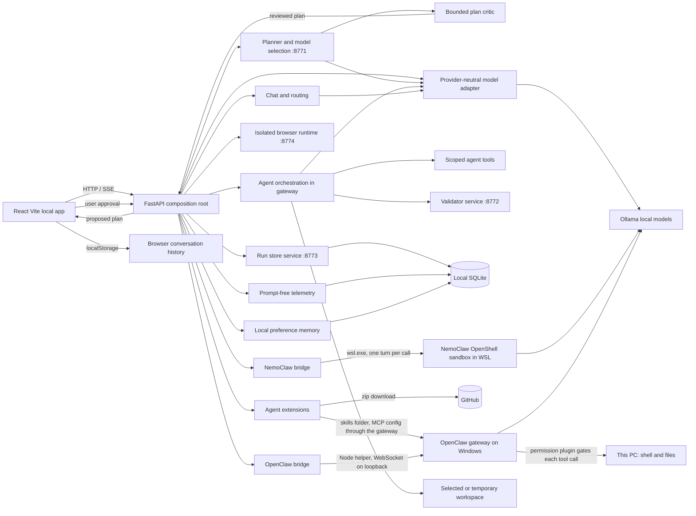

# PockPock AI architecture

This document describes the implemented local multi-process architecture and a staged path to grow it. Workflow stages with clear contracts run as separate loopback services, coordinated by a gateway API for a single-user local deployment. The browser client uses the public API; internal services are not exposed to the browser.

## Product and runtime boundary

The marketing concept in `frontend/site/` is a separate Next.js App Router deployment with `/` and `/app` routes. It currently uses static illustrative copy and client-side mock dashboard data; it has no connection to the FastAPI gateway and does not replace the local application above.

The browser client calls the FastAPI gateway, which owns public APIs, chat, model routing, and HTTP/SSE transport. Agent execution is owned by the in-process `backend/projects/agent_core/` application layer and invoked by the gateway after local request checks. Planning/model selection (including the bounded plan critic), workspace validation, run/event persistence, and isolated browser automation are separate FastAPI processes with explicit HTTP contracts. Planner, critic, agent tool calls, gateway route classification, code-completeness review, and gateway chat streaming use the provider-neutral `backend/projects/model_router/` contract, currently backed only by Ollama. The standalone Open WebUI integration can receive that contract through provider injection; without an injected provider it uses its self-contained Ollama path and does not require the backend package. Cloud model providers are not currently configured. All local services bind to loopback; internal HTTP calls require a per-install token. The cross-platform `backend/scripts/pockpock.py` launcher starts the backend separately from the browser frontend; legacy PowerShell launch scripts remain Windows-specific.

## Implemented module ownership

| Module | Responsibility | Boundary |
| --- | --- | --- |
| `frontend/app/src/App.tsx`, `frontend/app/src/shared/appData.ts` | Browser shell and top-level page composition; `appData.ts` owns the polled `/api/state` and the conversation list kept in browser storage | Chat UI, timeline, and run/workbench orchestration are owned by `frontend/app/src/features/chat/`; other feature modules remain separate |
| `frontend/app/src/features/chat/ChatView.tsx`, `ChatTimeline.tsx`, `ChatWorkspace.tsx` | Chat composer/transcript, run event timeline, and streaming/replay/approval coordination | Chat-owned UI and orchestration are composed by the app shell; agent execution remains in the agent workbench |
| `backend/scripts/pockpock.py`, `backend/scripts/pockpock_paths.py` | Cross-platform backend dependency setup, local service supervision, and platform-specific user data paths | Uses a repository-local Python environment and loopback-only services; Ollama and model weights remain separately installed |
| `desktop/electron/` (main process) and `desktop/src/` (renderer) | PockPock Agent desktop app: window, loopback server and `/api` forwarding, backend start/stop, chat and settings storage, workspace file access, terminal; React interface for chats, engines, plan review, approvals, skills, MCP, models, memory and settings | Separate npm project. Uses only the gateway's HTTP API; renderer is sandboxed and reaches the main process through named preload calls checked against the app origin. See [desktop app](features/desktop-app.md) |
| `frontend/site/app/`, `frontend/site/components/`, `frontend/site/data/` | Standalone Next.js marketing page and sample operations dashboard | Separate prototype routes with local mock data; no API, persistence, or integration with the local browser app |
| `frontend/app/src/BrowserRecipes.tsx` | Local recipe list, structured editor, version history, enable/disable, launch, transient inputs, approvals, and results | Calls same-PC gateway routes; run progress is also appended to the selected Conversations thread |
| `backend/scripts/frog_ai_server.py` | FastAPI app lifecycle, HTTP routes, local request policy, and chat | Browser-facing composition root; agent-run routes pass authenticated requests to the in-process core |
| `backend/projects/agent_core/executor.py` | Approved agent-run execution, model/tool coordination, delegation, cancellation, and finalization | In-process application layer with explicit `AgentCoreServices` dependencies; not a separate service process |
| `backend/projects/model_router/` | Provider-neutral chat-completion request contract and provider adapters | Ollama is the only configured provider; native JSON/context options and OpenAI-compatible tool calls are mapped by the adapter |
| `backend/projects/local_memory/` | Allowlisted, automatic local response-preference capture and review/delete storage | Stores only normalized preference values in SQLite; disabled state, individual deletion, and clear-all are user controlled |
| `backend/projects/observability/` | Prompt-free trace sink contract and deterministic routing evaluation report | Operational telemetry excludes prompts; synthetic evaluation cases emit only case IDs and aggregate/model-selection outcomes |
| `backend/scripts/agent_run_store.py` | Run/event schema, durable run lifecycle and cancellation state, event replay, and task journal writing | Persistence boundary used by routes and agent orchestration; owns run-history SQL and legacy-safe cancellation-column migration |
| `backend/projects/run_store/delegation_scheduler.py` | Bounded dependency scheduling and deterministic child-run identity | Scheduler and gateway child execution with scoped context, deadlines, cancellation, and durable typed results |
| `backend/projects/agent_tools/` | Agent tool contracts, shared contexts, registry/dispatch, workspace operations, public research/source and answer contracts, attachments, and artifacts | In-process capability package with focused modules and a stable facade; versioned schemas and runtime metadata validate calls/results before tool execution and model return. Research answers must cite known source IDs and exact retrieved quotes; conflicts require distinct sources. Public fetch tools are gated by a persisted local research-provider setting. |
| `backend/scripts/smart_router_pipe.py` | Open WebUI adapter for the local router | Uses an injected shared model provider when supplied; otherwise remains independently loadable with its native Ollama adapter path |
| `backend/scripts/observability_dashboard.py` | Prompt-free telemetry storage and Signal Room dashboard service | Telemetry adapter; prompts and responses must not be added to this store |
| `backend/projects/planner/app.py`, `critic.py` | Converts a user task into execution steps, selects an enabled tool-capable local model, and reviews the draft plan | Internal `/plan` HTTP API on port 8771; calls the shared model adapter for planning and bounded critique/repair. The user still approves the final plan before execution. |
| `backend/projects/validator/app.py` | Runs deterministic workspace validation | Internal `/validate` HTTP API on port 8772; imports validation implementation from `backend/projects/agent_tools` |
| `backend/projects/run_store/app.py` | Owns agent run/event persistence and cancellation endpoints | Internal run/event HTTP API on port 8773; SQLite remains the local durable store |
| `backend/projects/browser_automation/app.py`, `engines.py`, `recipes.py` | Owns isolated browser runs, browser-engine lifecycle, and browser workflow recipe contracts/persistence | Internal loopback HTTP API on port 8774; Playwright/Chromium default and optional single-context Lightpanda; contexts are ephemeral and recipes use a separate local SQLite database |
| `backend/projects/internal_auth.py` | Authenticates service-to-service requests | Shared loopback service token via `X-PockPock-Internal-Token` |
| `backend/projects/nemoclaw_bridge/` | Sends Conversations turns in NemoClaw mode to an externally installed NemoClaw sandbox in WSL and returns the reply as chat SSE events | In-process router mounted by the gateway; same-PC requests only; one `wsl.exe` process per turn with user text passed only through environment variables; PockPock does not install or manage NemoClaw. See [NemoClaw agent mode](features/nemoclaw-agent.md) |
| `backend/projects/openclaw_bridge/` | Sends Conversations turns in OpenClaw mode to an externally installed OpenClaw gateway on Windows, relays approval requests and decisions, and ships the permission plugin that enforces Ask first, Auto-approve safe, and Full access | In-process router mounted by the gateway; same-PC requests only; one Node helper process per turn speaking the gateway WebSocket protocol on loopback, with the request passed on stdin; per-session mode recorded in `~/.openclaw/pockpock/permissions.json`. See [OpenClaw agent mode](features/openclaw-agent.md) |
| `backend/projects/agent_extensions/` | Previews a pasted GitHub or MCP link and, after approval, installs skills into OpenClaw's skills folder or tests and saves an MCP server in OpenClaw's config; lists and removes what it installed | In-process router mounted by the gateway; same-PC requests only; outbound HTTPS to GitHub for previews; a short-lived Node helper for gateway config changes; one test start of an approved MCP server; manifest in `~/.openclaw/pockpock/extensions.json`. See [Agent engines, skills, and MCP servers](features/agent-extensions.md) |

The run store currently uses the same local SQLite database file as telemetry, but separate tables and an HTTP service boundary. `agent_runs` stores task identity and status; `agent_run_events` stores ordered, versioned JSON events for replay. Unversioned legacy payloads remain readable as version 0; new writes use version 1. Task memory is a Markdown projection of those durable events, stored with the task output. Separate preference memory stores only allowlisted, normalized response-style choices; raw prompts are not persisted, and the React Memory page supports review, disable, and deletion. Chat-only history remains in browser local storage. Browser automation owns disposable contexts only; it never opens the user's normal browser profile. Recipe definitions and revisions live in a second local SQLite database under `%LOCALAPPDATA%\FrogAI`, outside the repository and separate from run history. Recipe inputs store labels and types, not values. See [agent tool and run event contracts](features/agent-tool-contracts.md) and [the isolated browser runtime](features/browser-runtime.md).

The agent tool catalog and implementation now live under `backend/projects/agent_tools/`, with focused tests beside the package. `workspace.py`, `research.py`, and `artifacts.py` own their respective implementations; `registry.py` owns model schemas and dispatch; `contracts.py` is the source of truth for registered input/output schemas, permission, side effects, timeouts, and payload bounds. `__init__.py` preserves the public imports while the gateway consumes the package registry/dispatch interface. The gateway owns the local `frog_research_provider` setting and rejects research fetch calls when disabled; the UI shows the provider's network destination. The browser runtime is a separate loopback service because its browser processes need isolation; `browser_automation/engines.py` owns lifecycle adapters for default Playwright/Chromium and opt-in Lightpanda CDP. Lightpanda is loopback-only, limited to one active run context, and requires private-network blocking on its server; future model-callable browser tools still need typed schemas and registry dispatch in `backend/projects/agent_tools/`.

The Stop control calls `POST /api/runs/{run_id}/cancel`. The gateway asks the run store to durably mark the run `cancelling`, signals an in-process event, and races that signal against active planner/model/tool operations. Model calls and tools are cancelled cooperatively; tool-specific timeouts and a 15-minute total run deadline apply. The gateway also asks the browser runtime to close the run's Chromium context. Auto-review workspace patches are held until the run store resolves an approval bound to the patch diff. Browser actions in Default and Auto-review are similarly bound to the full action payload and observation ID, with typed values redacted from the persisted approval display. Both approval types expire after five minutes; run cancellation prevents pending work from applying. Approval and tool outcome events are persisted before being sent to the browser. If a connection disappears before the stream writes a terminal event, finalization appends `interrupted` or the persisted cancellation result. The run store rejects late events after cancellation or any terminal status.

### Desktop app

`desktop/` is a separate Electron app with its own React interface; it shares no code with `frontend/app`. Its main process serves the built interface from a loopback server (port 8790, or a free port) that also forwards `/api/*` to the gateway on 8766, so the page has one loopback origin and passes the gateway's same-PC check. The main process also owns chat and settings files in the app data folder, the Files panel (confined to the open folder), terminal sessions, and starting the backend when it is not running. See [PockPock Agent desktop app](features/desktop-app.md).

Decision: the desktop app is a client of the existing HTTP API rather than embedding the agent logic or loading the web dashboard. Engines, approvals and permission enforcement stay in one place (the gateway and the OpenClaw plugin), and the web dashboard keeps working unchanged. The trade-off is a second interface to maintain, and chats that are not shared between the two clients.

### Local service processes

| Process | Port | Health endpoint | Startup owner |
| --- | ---: | --- | --- |
| Web dashboard (Vite, development) | 5173 | `/` | `npm --prefix frontend/app run dev` |
| Gateway API | 8766 | `/api/health` | `backend/scripts/pockpock.py start` |
| Planner | 8771 | `/health` | `backend/scripts/pockpock.py start` |
| Validator | 8772 | `/health` | `backend/scripts/pockpock.py start` |
| Run store | 8773 | `/health` | `backend/scripts/pockpock.py start` |
| Browser automation | 8774 | `/health` | `backend/scripts/pockpock.py start` |

Run `backend/scripts/pockpock.py setup` once, then `backend/scripts/pockpock.py start` to supervise the backend services in the foreground. The internal token and logs use the per-user `FrogAI` data directory: `%LOCALAPPDATA%\\FrogAI` on Windows, `~/Library/Application Support/FrogAI` on macOS, or `${XDG_DATA_HOME:-~/.local/share}/FrogAI` on Linux. Internal ports bind only to `127.0.0.1`. Docker is not a runtime prerequisite. The older PowerShell launchers remain available on Windows.

## Request flows

### Chat

1. The browser submits a conversation and selected model/permission state to the API.
2. The API validates the request and resolves the local model route.
3. Explicit allowlisted preferences may be added as optional style guidance; the Ollama adapter streams the response through the shared model contract.
4. Prompt-free operational measurements may be recorded in telemetry. Conversation content stays in the browser unless it is part of an explicitly started agent task's local task journal.

### Adding a skill or MCP server

1. In Agent mode the browser recognizes a pasted GitHub or MCP link and posts it to `/api/extensions/inspect`. `agent_extensions` downloads the repository zip from GitHub (or, for a non-GitHub address, contacts nothing) and returns a proposal: the skills found, or the MCP server's command or address. Nothing is installed or run.
2. The browser shows the proposal as an approval card. On approval it posts the proposal id to `/api/extensions/install`.
3. Skills are extracted from the previewed archive into `~/.openclaw/skills/`. An MCP server is started once (or called, for a remote address) to list its tools, then saved to OpenClaw's `mcp.servers` through the gateway by a Node helper. What PockPock installed is recorded in `~/.openclaw/pockpock/extensions.json`.
4. The OpenClaw engine uses the skill or tools from the next turn; MCP tool calls pass through the permission plugin like any other tool.

Decision: skills and MCP servers are installed into OpenClaw rather than given a second implementation in the PockPock engine. OpenClaw already loads skills, runs MCP clients, and gates tool calls through the permission plugin, so PockPock only has to fetch, preview, and record. The trade-off is that the PockPock and NemoClaw engines do not see them. PockPock writes the skills folder and calls the gateway's config methods directly instead of the OpenClaw CLI, because the CLI refuses MCP changes while the gateway is running and its skill installer cannot preview a link before installing it.

### OpenClaw turn

1. In OpenClaw mode, the browser posts the newest message, a `pockpock-` session id, and the selected permission mode (`ask`, `auto`, or `full`) to `/api/openclaw/chat`.
2. The gateway applies the same-PC check and rate limit. `openclaw_bridge` records the mode for that session in `~/.openclaw/pockpock/permissions.json` and starts one `gateway_turn.mjs` Node helper, passing the request on stdin. Only one turn runs at a time.
3. The helper connects to the local OpenClaw gateway over WebSocket, confirms the `pockpock-permissions` plugin is loaded (required for `ask` and `auto`), and sends the message. OpenClaw runs its agent loop on Windows with no sandbox.
4. Before each tool call, the plugin's `before_tool_call` hook reads the session's mode and either allows the call or requests approval. Approval requests flow back as SSE `approval` events; the browser answers through `/api/openclaw/approvals`, which the bridge relays to the helper and the gateway.
5. Reply text streams as `token` and `replace` events and tool activity as `tool` events. Stop or a browser disconnect denies pending approvals and aborts the run. Nothing is written to telemetry or run tables.

Decision: permission modes are enforced by a plugin inside OpenClaw rather than by OpenClaw's built-in exec approval modes or by PockPock. The built-in modes cannot approve PowerShell cmdlets on native Windows, and PockPock cannot intercept tool calls from outside the agent loop. The trade-offs are a second runtime dependency (Node.js) for the helper, a plugin copy that must be reinstalled when its source changes, and that sessions started outside PockPock are not governed by it.

### NemoClaw turn

1. In NemoClaw mode, the browser posts the newest message and a per-conversation session id to `/api/nemoclaw/chat`.
2. The gateway applies the same-PC request check and rate limit, then `nemoclaw_bridge` runs `nemoclaw <sandbox> agent --json` through `wsl.exe` in a worker thread. Only one turn runs at a time.
3. OpenClaw runs inside the OpenShell sandbox with its own tools and network policy, using the Windows Ollama model through Docker Desktop. Session history lives in the sandbox, not in PockPock storage.
4. The bridge parses the JSON result and streams `decision`, `token`, and `done` events in the `/api/chat` format. A browser disconnect kills the WSL process. Nothing is written to telemetry or run tables.

Decision: NemoClaw is integrated as an external agent behind a narrow CLI boundary rather than as a `model_router` provider, because it owns its own tool loop, sandbox, and session state. The trade-offs are that replies arrive whole instead of streamed, there is no PockPock plan approval (the sandbox is the boundary), and each turn pays WSL process start-up cost.

### Agent task

1. The browser asks the planner to prepare a structured task brief and select a tool-capable local model; it includes an optional selected workspace and permission mode.
2. The planner critic checks scope, ordering, declared capabilities, and observable success checks. It may request one bounded revision; malformed or unusable planner/critic output fails instead of producing a generic plan.
3. The user reviews or edits the critic-reviewed steps and success checks. A short-lived one-use gateway ticket binds approval to the exact request, plan, critic review, permission, workspace, model, and execution prompt. The agent run endpoint rejects missing, changed, expired, or already-consumed tickets.
4. The API creates a durable run record and invokes `agent_core`, which chooses the selected workspace or creates a task output workspace and constructs explicit tool contexts.
5. The agent core sends model requests through the injected model-client interface and sends tool calls to the scoped tool dispatcher. Workspace access is rooted to the task workspace; public fetching is limited to hosts explicitly supplied by the user. Successful research calls collect typed source records and excerpts for final-answer validation.
6. Each SSE event is persisted by `agent_run_store` before it is forwarded to the browser. The browser renders the timeline and can reload it from the event API.
7. Code tasks must call `validate_project`. A failed result is returned to the model for repair and another validation attempt. The run is not reported as successful if validation does not pass.
8. After a research-tool call, the agent core validates the structured final response against retrieved sources and exact excerpts, retries invalid output at most twice, and renders valid claims, citations, conflicts, and limitations as Markdown. This validates citation provenance, not whether a quote semantically entails a claim.
9. The API writes `task-memory.md` with the request, plan, work log, and final report. Completed-run events retain the workspace path so the UI can reopen older workspaces.

The approved delegation plan is persisted by the parent run. Dependency-aware scheduling applies the configured local concurrency bound and deterministic child-run identity. The gateway claims each durable child exactly once, executes it with only its approved task context and tools, enforces child and parent deadlines, propagates cancellation, and persists one typed terminal result. The authenticated run-store claim route preserves the same behavior when the gateway uses remote persistence. MAG-04C covers timeline lifecycle/replay validation.

### Workspace validation

`validate_project` is a deterministic local tool, not a model-based confidence score. It scans only supported text files inside the selected root, validates Python and JavaScript syntax where available, checks relative HTML asset references, and, in Full Access mode, runs the existing `npm run build` and `npm run test` scripts when declared in `package.json`. Package scripts are executable project code, so they run only when Full Access was selected. Checks have timeouts and results include per-check status and actionable issues. A passing static check does not prove every user interaction works; projects should provide meaningful build/test scripts for behavior-level coverage.

## Security and trust boundaries

- **Workspace paths:** project tools reject absolute paths, traversal, symlinks, secrets, and paths outside the task root. Tool inputs use relative paths.
- **Execution:** there is no general shell tool. The validator runs only conventional npm build/test scripts, and only with Full Access. Do not expand this into arbitrary command execution without a separately designed permission and review flow.
- **Network:** public-site tools accept only explicitly supplied public hosts, standard HTTP(S) ports, and same-host navigation. Local/private IPs and cross-host redirects are rejected.
- **Telemetry:** telemetry must remain prompt-free. Agent event history is stored separately in run tables because it supports user-requested replay and task memory.
- **Preference memory:** automatic memory accepts only normalized allowlisted style preferences; never persist raw prompts, credentials, personal details, or inferred private facts. Users can inspect and delete every item or disable capture.
- **Evaluation:** offline routing checks use fixed synthetic labels and model profiles. Do not send user prompts, workspace data, or model responses to evaluation or telemetry storage.
- **Artifacts:** deliverables belong in the run's workspace/output folder; the UI receives explicit artifact paths and download/open actions.
- **Local API:** agent execution is accepted from the local browser only. Remote dashboard access must not silently grant workspace access.
- **Agent extensions:** a pasted link can add third-party instructions (skills) or programs (MCP servers) to the unsandboxed OpenClaw engine, so nothing is installed without an approval card that shows the source, commit, and exact command or address. Preview downloads only from GitHub and runs nothing; install applies the previewed archive, refuses unsafe paths and unknown launchers, saves an MCP server only after a successful test connection, and never replaces or removes entries PockPock did not create. Routes are same-PC only. PockPock does not review the content itself.
- **OpenClaw on the host:** OpenClaw mode runs an agent on this PC with no sandbox; the selected permission mode is the only gate, and Full access removes it. Enforcement lives in the `pockpock-permissions` plugin inside the OpenClaw gateway and fails closed: unknown tools, unrecognized commands, a missing mode record, an unanswered approval, or a missing plugin all ask or deny. Routes are same-PC only, user text reaches the helper on stdin, and the OpenClaw gateway listens on loopback with a token.
- **NemoClaw sandbox:** NemoClaw mode delegates to an agent that can run shell commands inside its OpenShell sandbox. PockPock passes user text only through `WSLENV` environment variables to a fixed script, restricts the routes to same-PC requests, and never mounts PockPock task workspaces into the sandbox. The sandbox's network policy is managed with NemoClaw, not PockPock.

## Growth principles

1. **Split stable workflow stages behind explicit contracts.** Keep each process independently launchable, and avoid adding services without clear ownership or a measurable operational boundary.
2. **Keep business orchestration out of routes.** Route handlers should validate transport input, invoke a use case, and map results/errors to HTTP/SSE.
3. **Use adapters for replaceable infrastructure.** Model APIs, SQLite repositories, filesystem workspace operations, and telemetry should be behind narrow interfaces before introducing alternatives. Gateway model requests use the shared contract; the separately loadable Open WebUI pipe accepts that contract by injection and retains its native Ollama path when loaded alone.
4. **Persist contracts, not in-memory assumptions.** Run identity, status, event order, and workspace references belong in durable records. Process-local maps may cache active state but cannot be the only source for reopening completed work.
5. **Make long-running work resumable.** SSE is a delivery mechanism; the run event log remains the recovery source after reload or disconnect.
6. **Keep permissions explicit and task-scoped.** New tools must declare their capability, input limits, side effects, permission requirements, and audit events.
7. **Keep docs beside code changes.** Follow [`AGENTS.md`](../AGENTS.md) and the feature index.

## Planned local interaction boundaries (AUT-01)

These are design decisions for future work, not descriptions of implemented modules:

- Keep the existing isolated Playwright/Chromium runtime as the default. The optional Lightpanda CDP adapter is limited to its verified features and reports its one-context capacity; unsupported behavior must remain explicit rather than silently falling back.
- Connect signed-in Chrome only through a user-paired extension and local Native Messaging host for one explicitly selected tab. Do not attach to a whole profile through remote debugging or expose the Chrome debugging permission.
- Put native desktop control behind a separate Windows 11 x64 adapter for one user-selected foreground window; website interaction remains a browser capability.
- Keep command schemas and permission checks in `backend/projects/agent_tools/`; run only explicitly configured named profiles, not model-authored shell strings. Any process runner must disclose that it runs with the user's OS account rights unless a separately verified OS sandbox is added.
- Keep gateway approval decisions and run-store event ownership authoritative. A future worker queue may run only saved, user-enabled schedule definitions; it cannot grant permissions or auto-approve actions. Schedules use bounded attempts and skip missed occurrences after restart.
- `backend/projects/chrome_companion/` now contains the Windows pairing extension, Native Messaging host, and authenticated in-memory relay scaffold. It currently relays only `ping`; page observation, screenshots, approval-bound actions, and agent-tool integration remain planned. `backend/projects/desktop_automation/` remains proposed. See [the full local interaction design](features/local-agent-automation.md).

## Staged architecture roadmap

These are proposed phases, not claims about current implementation.

### Phase 1: Workflow service boundaries (implemented first slice)

- Extract agent-run persistence from the API module (implemented in `backend/scripts/agent_run_store.py`).
- Planner, validator, and run/event persistence now run as separate HTTP services. The agent execution loop still lives in the gateway and is the next extraction boundary.
- Split the large React composition into `features/conversations`, `features/agents`, `features/models`, and `features/overview`, with shared UI and typed API clients.
- Centralize environment-backed configuration and validate it once during startup.

### Phase 2: Reliability and contracts

- Add versioned API schemas and typed frontend clients.
- Add migrations for SQLite instead of startup-only `CREATE TABLE IF NOT EXISTS` evolution.
- Add structured error types, request/run correlation IDs, cancellation, per-run limits, and explicit retry policy.
- Add focused unit/integration coverage for routing, permission enforcement, event replay, workspace validation, and representative UI flows.

### Phase 3: Multi-user or high-concurrency deployment (only when required)

- Introduce authenticated identities and per-user workspace/artifact isolation before exposing the API beyond loopback.
- Move run/event storage to PostgreSQL with managed migrations and backups; keep repositories behind the same contract.
- Move execution into a durable worker queue with leases, idempotency keys, cancellation, and bounded concurrency.
- Move large artifacts to object storage and store metadata/ownership in the database.
- Add service health, metrics, tracing, retention policies, and operational restore procedures.

This local deployment uses process-separated services to isolate planning, validation, and run persistence. It does not yet provide independent packaging/versioning, horizontal scaling, or multi-user isolation. Add those only with their own deployment, compatibility, and data-ownership plans; scaling the agent execution loop requires a worker queue and durable leases.

## Decision record

### Loopback workflow services for the desktop deployment

- **Decision:** run planning, validation, and agent event persistence in separate authenticated loopback processes, with the gateway coordinating browser requests.
- **Reason:** those workflow stages have stable interfaces and distinct resource/failure boundaries, and can evolve independently behind the current browser API.
- **Tradeoff:** processes still share a repository, Python environment, and local SQLite database. The agent execution loop and tool implementations remain gateway-coupled, so this is a first extraction slice rather than independently deployable microservices.

### Durable agent event log

- **Decision:** persist ordered agent events separately from prompt-free telemetry and replay from that log.
- **Reason:** users need progress and results to survive reloads, and the task workspace needs a durable open/recovery pointer.
- **Tradeoff:** task event payloads can include work details, so access remains local and retention/cleanup needs a future explicit policy.

### Bounded agent replanning

- **Decision:** keep tool-failure retry state in a small planner helper owned by the gateway run, and persist user-visible `plan_revision` events in the existing ordered run log.
- **Reason:** failed tools should inform remaining work without creating an unbounded model loop or losing completed tool outcomes.
- **Boundary:** repeated identical tool actions stop after two failures and failure-triggered replanning stops after five revisions. Argument fingerprints are in-memory hashes only; revision events contain step names and short rationale, not tool arguments. Existing tool approvals, run deadlines, validation gates, and artifact gates remain authoritative.

### Parent/child run ownership

- **Decision:** store delegation metadata on each run row and store typed delegate results in the existing ordered event log.
- **Reason:** replay can reconstruct parent/child relationships and results after service restart without coupling the run store to a coordinator implementation.
- **Boundary:** the run store validates same-conversation parent links, completed sibling dependencies, a maximum of 16 direct children, and three levels of delegation. The gateway enforces child context/tool/workspace scopes, deadlines, cancellation, and atomic one-time dispatch claims. Synthesis receives bounded typed results keyed by subtask and child-run ID; failed or missing required children force a partial parent outcome. All records retain the existing local run-history ownership and retention behavior.

### Capability-aware planning route

- **Decision:** the gateway filters candidates against Ollama's tool-call capability and supplies context-window and numeric latency metadata to the planner.
- **Reason:** the planner can preserve a compatible user choice, avoid known context overflow, and select the configured default or faster measured candidate without sending task content to telemetry.
- **Boundary:** context unknown remains eligible; latency is based on local numeric model-call aggregates only. Synthetic evaluation cases contain no prompts or outputs. Outcome-based routing is not enabled.

### Coordinator subtask planning

- **Decision:** represent proposed delegation as a validated topological subtask list in the parent plan response and bind it into the existing one-use approval ticket.
- **Reason:** users can inspect the purpose, dependencies, tools, and budgets before any child is eligible to launch; approval cannot be replayed with a changed graph.
- **Boundary:** child execution begins only after parent approval and follows the stored child contract. Typed result synthesis requires explicit child-run attribution and disagreement reporting; merged workspace changes still require the existing review and validation safeguards.
