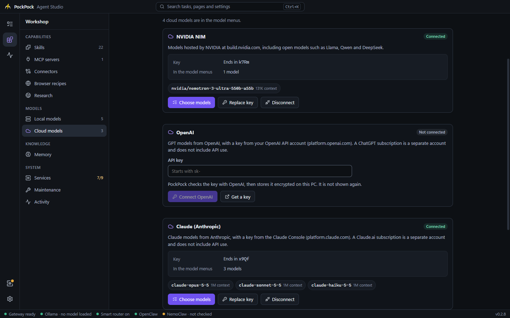
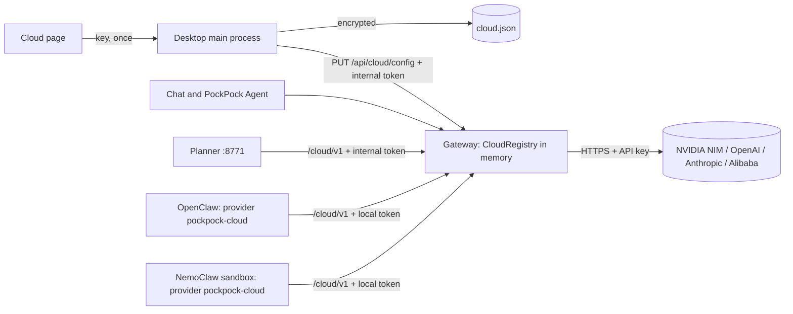

# Cloud models

PockPock runs local models by default. The **Cloud models** page connects cloud services so their models can be chosen, next to the local ones, in the model menus of **Chat**, **PockPock Agent**, **OpenClaw** and **NemoClaw**. The user brings their own account and API key and pays the service directly.

Supported services, all through their OpenAI-compatible chat-completions API:

| Service | Id | Address | Key check |
|---|---|---|---|
| NVIDIA NIM (build.nvidia.com) | `nim` | `https://integrate.api.nvidia.com/v1` | A one-token reply from a small model in NVIDIA's current list |
| OpenAI (platform.openai.com) | `openai` | `https://api.openai.com/v1` | `GET /models` with `Authorization: Bearer` |
| Claude by Anthropic (platform.claude.com) | `anthropic` | `https://api.anthropic.com/v1` (chat through Anthropic's OpenAI-compatible endpoint) | `GET /models?limit=1000` with `x-api-key` and `anthropic-version: 2023-06-01` |
| Alibaba Cloud Model Studio (DashScope) | `alibaba` | `https://dashscope-intl.aliyuncs.com/compatible-mode/v1` (Singapore), `https://dashscope-us.aliyuncs.com/compatible-mode/v1` (Virginia), `https://dashscope.aliyuncs.com/compatible-mode/v1` (Beijing) | `GET /models` |

OpenRouter was offered up to 0.2.8 and was removed in favour of connecting OpenAI and Anthropic directly. A saved OpenRouter key is deleted from `cloud.json` when the app starts, and saved model choices that named an `openrouter/…` model go back to their defaults.

OpenAI and Claude need an **API** key from the developer platform, billed per use. A ChatGPT or Claude.ai subscription is a separate account and does not include API use; the Cloud page says so.

## User flow

| The Cloud models page | The model menu |
|---|---|
|  |  |

*The screenshots show sample models and sample key endings (NVIDIA NIM and Claude connected), not a real account.*

1. Open **Workshop → Cloud models**. Each service shows **Not connected**, **Connected**, or **Key needed again**.
2. Paste the API key (for Alibaba, choose the region the key belongs to) and press **Connect**. **Get a key** opens the service's key page in the browser.
3. PockPock checks the key with the service. A refused key is not saved, and the reason is shown (wrong key, wrong region, no credit, rate limit, service unreachable).
4. On the first connection the suggested models that the service currently offers are switched on (for OpenAI and Claude, when none of the suggested names is offered, the three newest GPT or Claude models are switched on instead, since model names change often). **Choose models** opens a searchable list of the service's chat models (embedding, image, speech and safety models are left out); ticked models appear in the model menus. At most 40 per service.
5. In a chat, open the model menu. Cloud models are listed under **Cloud models · sent to the provider**, with the service name under each.
6. **Replace key** stores a new key and keeps the chosen models. **Disconnect** deletes the key from the computer and removes the service's models from every menu, and everything that was set to one of them goes back to its default (see [Disconnecting and switching models off](#disconnecting-and-switching-models-off)).

## Disconnecting and switching models off

When a service is disconnected, or one of its models is unticked in **Choose models**, nothing is left pointing at a model that is no longer there:

| What used the model | What happens | Where |
|---|---|---|
| The gateway's copy (chat, PockPock Agent, the planner, the local endpoint) | The new configuration is pushed at once; requests for the removed model get `409` "not switched on" | `Cloud.changed()` → `push()` |
| OpenClaw's `pockpock-cloud` provider | Rewritten from the remaining models, or removed when none is left. A chat that had a removed model goes back to OpenClaw's default model on its next turn, because the app no longer sends a model | `syncCloudToOpenClaw()` in `main.cjs` (on every change) |
| NemoClaw's sandbox model | If the sandbox uses a model that was removed, it goes back to its remembered local model (`PUT /api/nemoclaw/model` with an empty model). Asked only when a model was removed, because reading the sandbox's model runs a command in WSL. Best effort: when NemoClaw is not installed or not running nothing changes, and the menu then shows the route as it is | `Cloud.releaseNemoClaw()` |
| The app's saved choices: the chat model (Chat and PockPock Agent), OpenClaw's model and the **Plan in steps** planner | Cleared, so each falls back to its default (Smart route, OpenClaw's default, one model plans and works). Checked at start and after every cloud change, so it also clears choices left from a service that is no longer offered | `desktop/src/lib/cloudCleanup.ts` (`useCloudCleanup`) |

The order matters for NemoClaw: the gateway is told first, then the sandbox is moved back, so it never runs a turn on a model the gateway no longer serves.

## What is sent where

- A cloud model receives the messages, attached files and tool results of the chats that use it, under the user's own account. The Cloud page says so.
- A cloud model is used **only when it is chosen by name**. **Smart route** and the agent's automatic model choice consider local models only. When a chosen cloud model fails (bad key, no credit, rate limit), the chat shows the error; it does not switch to another model.
- No telemetry about cloud use is sent anywhere.

## Model names

A cloud model is named `<service id>/<model id>`, for example `nim/nvidia/nemotron-3-ultra-550b-a55b`, `openai/gpt-5.1` or `anthropic/claude-opus-5-5` (pattern: `^(nim|openai|anthropic|alibaba)/[A-Za-z0-9][A-Za-z0-9._:/-]{0,87}$`, at most 100 characters). Any other name is a local Ollama model. The menus show the model id and the service name.

## Claude and OpenAI request differences

Every caller sends an OpenAI chat-completions body. Before it leaves the gateway (both the gateway's own requests and the `/cloud/v1` endpoint used by OpenClaw, NemoClaw and the planner), `adapt_body()` in `model_router/cloud.py` fits it to the service:

- **Claude** goes through Anthropic's OpenAI-compatible endpoint (`/v1/chat/completions`, the key as a Bearer token). Checked against Anthropic's documentation on 2026-11-22: current Claude models refuse `temperature` below 1 and any `top_p` (400), some refuse a forced tool call, and `response_format` is accepted only as `json_schema` with `strict: true`. The gateway drops `temperature`, `top_p` and `n`, turns a forced `tool_choice` (`"required"` or a named function) into `"auto"`, and drops any other `response_format` (the prompts that ask for JSON say so in their text). Prompt caching and Claude's own features (thinking display, citations) are not available through this endpoint.
- **OpenAI** reasoning models (`o…`, `gpt-5` and later) take `max_completion_tokens` instead of `max_tokens` and only the default temperature: `max_tokens` is renamed and `temperature` and `top_p` are dropped for them. Older GPT models get the body unchanged.
- NVIDIA NIM and Alibaba get the body unchanged.

## Modules and data flow

| Path | Role |
|---|---|
| `desktop/electron/cloud.cjs` | `Cloud`: the provider catalog (every address is a constant), key check, model listing (`normalizeModels`), the encrypted store, `push()` to the gateway, `releaseNemoClaw()` after a removal, and `forgetRetired()` for providers no longer offered. Tests: `cloud.test.cjs` |
| `desktop/src/lib/cloudCleanup.ts` | `useCloudCleanup`: clears saved model choices that name a cloud model that is no longer chosen |
| `desktop/electron/cloud-openclaw.cjs` | `syncOpenClaw`: writes or removes the `pockpock-cloud` provider in OpenClaw's configuration |
| `desktop/electron/main.cjs` | IPC `cloud:list`, `cloud:connect`, `cloud:available`, `cloud:setModels`, `cloud:disconnect` (all through `handle()`); re-sends the configuration when the gateway comes up |
| `desktop/src/pages/CloudPage.tsx` | The Cloud page |
| `desktop/src/components/ChatPane.tsx` | Cloud models in the model menus of all engines; NemoClaw's sandbox model menu |
| `backend/projects/model_router/cloud.py` | `CloudRegistry` (connected providers, in memory), `adapt_body` (per-service request fields), `OpenAICompatibleAdapter`, `RegistryCloudProvider`, `RoutingChatCompletionProvider`. Tests: `test_cloud.py` |
| `backend/projects/model_router/cloud_api.py` | Gateway routes: `PUT /api/cloud/config`, `GET /api/cloud/models`, and the local endpoint `/cloud/v1` |
| `backend/projects/openclaw_bridge/gateway_turn.mjs` | Lists the `pockpock-cloud` models and sets `pockpock-cloud/<name>` as the session model |
| `backend/projects/nemoclaw_bridge/bridge.py`, `api.py` | `route()` and `set_model()`; `GET`/`PUT /api/nemoclaw/model` |

1. **Keys.** The page sends the key to the main process once (`cloud:connect`). After the check it is encrypted with Electron `safeStorage` (DPAPI on Windows, the Keychain on macOS) and written to `<userData>/cloud.json` together with the region, the chosen models and the last four characters of the key. The key is never returned to the page; `cloud:list` carries only those four characters. If `safeStorage` is unavailable the key is not saved.
2. **Gateway.** `Cloud.push()` sends providers, keys and chosen models to `PUT /api/cloud/config` on loopback, protected by the internal service token. The gateway keeps them in memory only (`CloudRegistry`), so they are sent again whenever the gateway starts, and once a minute the main process compares the gateway's model count with its own and re-sends after a gateway restart. The gateway accepts a provider address only when its host is on the fixed list in `PROVIDER_HOSTS` and it uses HTTPS, so a pushed configuration cannot send a key elsewhere.
3. **Chat and PockPock Agent.** The gateway's model client is `RoutingChatCompletionProvider`: cloud names go to `RegistryCloudProvider`, which looks up the provider, replaces the name with the provider's own model id and adds the key; every other name goes to the Ollama adapter. `/api/chat` accepts a cloud model without asking Ollama for anything; `/api/agents/plan` adds the chosen cloud model's profile to the planner's candidates for that request; the agent run keeps the plan's cloud model. `GET /api/state` lists the chosen models as `cloud_models` (no keys).
4. **The local endpoint.** `/cloud/v1/chat/completions` and `/cloud/v1/models` on the gateway are an OpenAI-compatible endpoint for the other processes on the computer. Callers send a cloud name and a local bearer token (the *local cloud token* from `cloud.json`, or the internal service token); the gateway forwards the request to the provider with the real key and relays the reply, streaming included. The planner service uses it with the internal token, so it holds no key.
5. **OpenClaw.** `syncOpenClaw` runs `openclaw config set models.providers.pockpock-cloud …` with `baseUrl` `http://127.0.0.1:8766/cloud/v1`, `api` `openai-completions`, the local cloud token as `apiKey`, and one entry per chosen model (id = the cloud name, context window from the provider's list or 128,000). With no cloud models the provider is removed. OpenClaw's configuration file therefore never contains a cloud API key. The OpenClaw model menu lists these next to the Ollama models; a chosen one is set on the session as `pockpock-cloud/<name>`.
6. **NemoClaw.** The sandbox's model is one sandbox-wide inference route in OpenShell, not a per-chat setting. `PUT /api/nemoclaw/model` with a cloud name (a) remembers the current local route (gateway setting `nemoclaw_local_route`), (b) creates or updates the OpenShell provider `pockpock-cloud` (type `openai`, `OPENAI_BASE_URL` `http://host.openshell.internal:<gateway port>/cloud/v1`, credential = the local cloud token, passed through the environment and never on a command line), and (c) runs `openshell inference set --provider pockpock-cloud --model <name> --no-verify`. An empty model restores the remembered local route. The menu says the choice applies to every NemoClaw chat. `GET /api/nemoclaw/model` reports the current route without loading a model.

## API contract

- `PUT /api/cloud/config` (header `X-PockPock-Internal-Token`): `{ providers: [{ id, base_url, api_key, models: [{ id, context_window }] }], proxy_token }`. Replaces the whole configuration. `422` for an unknown provider, a host outside the allow-list or a malformed key; on failure the earlier configuration stays.
- `GET /api/cloud/models`: `{ models: [{ name, provider, provider_label, context_window }] }`.
- `POST /cloud/v1/chat/completions` (header `Authorization: Bearer <local cloud token | internal token>`): an OpenAI chat-completions body whose `model` is a cloud name. `401` without a valid token, `409` when the provider is not connected or the model is not switched on, the provider's own status for provider errors, `502` when the provider cannot be reached, `413` over 8 MB.
- `GET /cloud/v1/models`: the chosen models in OpenAI list format.
- `GET /api/nemoclaw/model`: `{ cloud, model, provider, local: { provider, model, timeout }, cloud_models }`. `PUT /api/nemoclaw/model` `{ model }`: the same shape after the change; `409` while a NemoClaw turn is running, when the model is not connected, or when no local route is remembered.

## Failure states

- Wrong key, wrong Alibaba region, no credit, rate limit, service unreachable or timing out: shown on the Cloud page at connect, or as the chat's error when a turn fails. The message never contains the key.
- NVIDIA's key check sends a one-token request to up to six models from its current list **at the same time** (12 s each) and takes the first answer that says something about the key. Measured 2026-11-22: a wrong or missing key is refused at once (401/403) by any listed model; with a good key a model answers, fails with a server error (500), or answers 404 "Not found for account" when this account cannot use it, which still means NVIDIA read the key. A 410, a plain 404 and a timeout say nothing about the key. Before this, the models were tried one at a time with 30 s each, and a listed model that never answered (`minimaxai/minimax-m3.1-flash` at the time) made a good key fail with "NVIDIA NIM could not be reached (it did not answer in time)". If every model times out the message is still "did not answer in time"; if none of them says anything about the key it is "could not check the key right now".
- Not every listed NVIDIA model answers for every account. On 2026-11-22, with one account: `nvidia/nemotron-3-ultra-550b-a55b`, `nvidia/nemotron-3.5-lightning-30b-a3b`, `nvidia/nemotron-3.5-bolt-e4b` and `poolside/laguna-xs-2.1` answered in about a second, `moonshotai/kimi-k3.1-pro` and `mistralai/mistral-large-4-1t-a52b` in 20–40 s; some Gemma and Cosmos models answered 404 "not found for account"; `z-ai/glm-5.3-flash`, `stepfun-ai/step-5-preview` and `google/gemma-4-31b-it` did not answer within 45 s. The models chosen for you when you connect (the suggestions) are now ones that answered.
- The saved key cannot be decrypted (the files were copied to another computer or user account): the service shows **Key needed again**; nothing is sent to the gateway for it.
- The gateway is not running when a provider is connected: the configuration is saved and sent when the gateway comes up.
- OpenClaw is not installed or its configuration cannot be written: the Cloud page still works for the other engines; the error is logged by the main process.
- NemoClaw is busy, Docker is not running, or OpenShell refuses the provider or route: the model menu shows the reason and the route is unchanged.
- A cloud model without tool calling used with an agent engine: the provider or the agent reports the failure. When a service says which models support tools, the chooser marks the others "no tool calls: chat only"; none of the current services says so in its model list.
- NemoClaw cannot be reached when a service is disconnected: the disconnect still completes; if the sandbox was on one of its models, choose its model again in the NemoClaw menu (or disconnect again once NemoClaw runs).

## Limits

- PockPock Agent still needs Ollama for its local task classification, even when the plan and the run use a cloud model. Chat with a chosen cloud model works without Ollama.
- NemoClaw's model is shared by all its chats; switching it while a NemoClaw turn runs is refused.
- Cloud models are not offered to the Maintenance Manager's "PockPock itself" agent.
- Prices and remaining credit are not shown; check the service's own dashboard.

## Verification

- `npm test` in `desktop/` (`cloud.test.cjs`): model-list parsing (OpenAI's list without names, Anthropic's `display_name` and `max_input_tokens`), key validation, connect/replace/disconnect, Anthropic's `x-api-key` and `anthropic-version` headers, the newest-model fallback, NemoClaw moved back to its local model only when its model was removed, a disconnect that completes without NemoClaw, the deleted OpenRouter key, the encrypted store never holding the key in plain text, the gateway push, the Alibaba region, NVIDIA's key check, and the OpenClaw provider.
- `python -m unittest projects.model_router.test_cloud projects.nemoclaw_bridge.test_bridge` in `backend/`: names, the host allow-list, `adapt_body` for Claude and OpenAI, the adapter against a local stand-in provider (reply, stream, errors, no `temperature` sent to Claude), routing, the local endpoint's token check and its rewrite of OpenClaw's body, and NemoClaw's switch to a cloud model and back.
- Real checks made on 2026-11-16: model-list parsing against the public OpenRouter and NVIDIA lists; a made-up key refused by all three real services; chat, the local endpoint and a PockPock Agent plan through a stand-in provider on an isolated gateway and planner; the Cloud page and all model menus in the real app at 1440 and 820 px.
- Real NVIDIA NIM key, 2026-11-22: connected in 0.4 s with the fixed check (it had failed with "did not answer in time"); every chat model probed (above); and a **Plan in steps** run through the gateway's `/cloud/v1` with `nvidia/nemotron-3-ultra-550b-a55b` as planner and local `qwen3.5:9b` for the steps: planned in 22 s, both steps checked, `summary.md` written into the open folder after approval with the right content. The key appeared in no log or data file of the run.
- OpenAI and Claude, 2026-11-22, in the real app with a temporary data folder: made-up keys refused by the real `api.openai.com` and `api.anthropic.com` (401, so Anthropic accepted the headers) and nothing saved; saved choices `anthropic/…`, `openai/…` and `openrouter/…` with nothing connected were cleared at start while other settings stayed; the Cloud page lists the four services and passes axe.
- **Not verified yet:** a connection and a chat with a real OpenAI or Anthropic key (model-list parsing and the request rewrite are tested against stand-ins built from the documented formats); a connection with a real Alibaba key; a real OpenClaw turn and a real NemoClaw turn on a cloud model (including that the sandbox can reach the gateway at `host.openshell.internal`); a full PockPock Agent run with tools on a cloud model; macOS.
