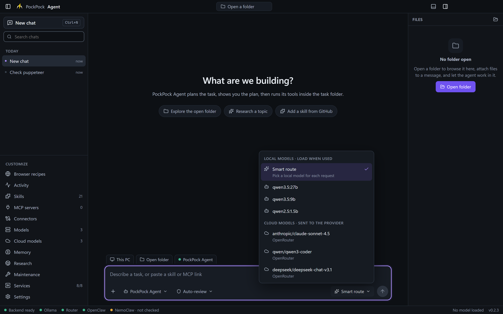

# Cloud models

PockPock runs local models by default. The **Cloud models** page connects cloud services so their models can be chosen, next to the local ones, in the model menus of **Chat**, **PockPock Agent**, **OpenClaw** and **NemoClaw**. The user brings their own account and API key and pays the service directly.

Supported services, all through their OpenAI-compatible chat-completions API:

| Service | Id | Address | Key check |
|---|---|---|---|
| NVIDIA NIM (build.nvidia.com) | `nim` | `https://integrate.api.nvidia.com/v1` | A one-token reply from a small model in NVIDIA's current list |
| OpenRouter | `openrouter` | `https://openrouter.ai/api/v1` | `GET /key` |
| Alibaba Cloud Model Studio (DashScope) | `alibaba` | `https://dashscope-intl.aliyuncs.com/compatible-mode/v1` (Singapore), `https://dashscope-us.aliyuncs.com/compatible-mode/v1` (Virginia), `https://dashscope.aliyuncs.com/compatible-mode/v1` (Beijing) | `GET /models` |

## User flow

| The Cloud models page | The model menu |
|---|---|
|  |  |

*The screenshots show sample models and a sample key ending, not a real account.*

1. Open **Workshop → Cloud models**. Each service shows **Not connected**, **Connected**, or **Key needed again**.
2. Paste the API key (for Alibaba, choose the region the key belongs to) and press **Connect**. **Get a key** opens the service's key page in the browser.
3. PockPock checks the key with the service. A refused key is not saved, and the reason is shown (wrong key, wrong region, no credit, rate limit, service unreachable).
4. On the first connection the suggested models that the service currently offers are switched on. **Choose models** opens a searchable list of the service's chat models (embedding, image, speech and safety models are left out); ticked models appear in the model menus. At most 40 per service.
5. In a chat, open the model menu. Cloud models are listed under **Cloud models · sent to the provider**, with the service name under each.
6. **Replace key** stores a new key and keeps the chosen models. **Disconnect** deletes the key from the computer and removes the service's models from every menu.

## What is sent where

- A cloud model receives the messages, attached files and tool results of the chats that use it, under the user's own account. The Cloud page says so.
- A cloud model is used **only when it is chosen by name**. **Smart route** and the agent's automatic model choice consider local models only. When a chosen cloud model fails (bad key, no credit, rate limit), the chat shows the error; it does not switch to another model.
- No telemetry about cloud use is sent anywhere. OpenRouter requests carry the app name (`X-Title: PockPock Agent`) and the project URL as referer, as OpenRouter asks of apps; no user data is in those headers.

## Model names

A cloud model is named `<service id>/<model id>`, for example `nim/deepseek-ai/deepseek-v4.1-flash` or `openrouter/anthropic/claude-sonnet-4.5` (pattern: `^(nim|openrouter|alibaba)/[A-Za-z0-9][A-Za-z0-9._:/-]{0,87}$`, at most 100 characters). Any other name is a local Ollama model. The menus show the model id and the service name.

## Modules and data flow

| Path | Role |
|---|---|
| `desktop/electron/cloud.cjs` | `Cloud`: the provider catalog (every address is a constant), key check, model listing (`normalizeModels`), the encrypted store, and `push()` to the gateway. Tests: `cloud.test.cjs` |
| `desktop/electron/cloud-openclaw.cjs` | `syncOpenClaw`: writes or removes the `pockpock-cloud` provider in OpenClaw's configuration |
| `desktop/electron/main.cjs` | IPC `cloud:list`, `cloud:connect`, `cloud:available`, `cloud:setModels`, `cloud:disconnect` (all through `handle()`); re-sends the configuration when the gateway comes up |
| `desktop/src/pages/CloudPage.tsx` | The Cloud page |
| `desktop/src/components/ChatPane.tsx` | Cloud models in the model menus of all engines; NemoClaw's sandbox model menu |
| `backend/projects/model_router/cloud.py` | `CloudRegistry` (connected providers, in memory), `OpenAICompatibleAdapter`, `RegistryCloudProvider`, `RoutingChatCompletionProvider`. Tests: `test_cloud.py` |
| `backend/projects/model_router/cloud_api.py` | Gateway routes: `PUT /api/cloud/config`, `GET /api/cloud/models`, and the local endpoint `/cloud/v1` |
| `backend/projects/openclaw_bridge/gateway_turn.mjs` | Lists the `pockpock-cloud` models and sets `pockpock-cloud/<name>` as the session model |
| `backend/projects/nemoclaw_bridge/bridge.py`, `api.py` | `route()` and `set_model()`; `GET`/`PUT /api/nemoclaw/model` |

1. **Keys.** The page sends the key to the main process once (`cloud:connect`). After the check it is encrypted with Electron `safeStorage` (DPAPI on Windows, the Keychain on macOS) and written to `<userData>/cloud.json` together with the region, the chosen models and the last four characters of the key. The key is never returned to the page; `cloud:list` carries only those four characters. If `safeStorage` is unavailable the key is not saved.
2. **Gateway.** `Cloud.push()` sends providers, keys and chosen models to `PUT /api/cloud/config` on loopback, protected by the internal service token. The gateway keeps them in memory only (`CloudRegistry`), so they are sent again whenever the gateway starts, and once a minute the main process compares the gateway's model count with its own and re-sends after a gateway restart. The gateway accepts a provider address only when its host is on the fixed list in `PROVIDER_HOSTS` and it uses HTTPS, so a pushed configuration cannot send a key elsewhere.
3. **Chat and PockPock Agent.** The gateway's model client is `RoutingChatCompletionProvider`: cloud names go to `RegistryCloudProvider`, which looks up the provider, replaces the name with the provider's own model id and adds the key; every other name goes to the Ollama adapter. `/api/chat` accepts a cloud model without asking Ollama for anything; `/api/agents/plan` adds the chosen cloud model's profile to the planner's candidates for that request; the agent run keeps the plan's cloud model. `GET /api/state` lists the chosen models as `cloud_models` (no keys).
4. **The local endpoint.** `/cloud/v1/chat/completions` and `/cloud/v1/models` on the gateway are an OpenAI-compatible endpoint for the other processes on the computer. Callers send a cloud name and a local bearer token (the *local cloud token* from `cloud.json`, or the internal service token); the gateway forwards the request to the provider with the real key and relays the reply, streaming included. The planner service uses it with the internal token, so it holds no key.
5. **OpenClaw.** `syncOpenClaw` runs `openclaw config set models.providers.pockpock-cloud …` with `baseUrl` `http://127.0.0.1:8766/cloud/v1`, `api` `openai-completions`, the local cloud token as `apiKey`, and one entry per chosen model (id = the cloud name, context window from the provider's list or 128,000). With no cloud models the provider is removed. OpenClaw's configuration file therefore never contains a cloud API key. The OpenClaw model menu lists these next to the Ollama models; a chosen one is set on the session as `pockpock-cloud/<name>`.
6. **NemoClaw.** The sandbox's model is one sandbox-wide inference route in OpenShell, not a per-chat setting. `PUT /api/nemoclaw/model` with a cloud name (a) remembers the current local route (gateway setting `nemoclaw_local_route`), (b) creates or updates the OpenShell provider `pockpock-cloud` (type `openai`, `OPENAI_BASE_URL` `http://host.openshell.internal:<gateway port>/cloud/v1`, credential = the local cloud token, passed through the environment and never on a command line), and (c) runs `openshell inference set --provider pockpock-cloud --model <name> --no-verify`. An empty model restores the remembered local route. The menu says the choice applies to every NemoClaw chat. `GET /api/nemoclaw/model` reports the current route without loading a model.

## API contract

- `PUT /api/cloud/config` (header `X-PockPock-Internal-Token`): `{ providers: [{ id, base_url, api_key, models: [{ id, context_window }] }], proxy_token }`. Replaces the whole configuration. `422` for an unknown provider, a host outside the allow-list or a malformed key; on failure the earlier configuration stays.
- `GET /api/cloud/models`: `{ models: [{ name, provider, provider_label, context_window }] }`.
- `POST /cloud/v1/chat/completions` (header `Authorization: Bearer <local cloud token | internal token>`): an OpenAI chat-completions body whose `model` is a cloud name. `401` without a valid token, `409` when the provider is not connected or the model is not switched on, the provider's own status for provider errors, `502` when the provider cannot be reached, `413` over 8 MB.
- `GET /cloud/v1/models`: the chosen models in OpenAI list format.
- `GET /api/nemoclaw/model`: `{ cloud, model, provider, local: { provider, model, timeout }, cloud_models }`. `PUT /api/nemoclaw/model` `{ model }`: the same shape after the change; `409` while a NemoClaw turn is running, when the model is not connected, or when no local route is remembered.

## Failure states

- Wrong key, wrong Alibaba region, no credit, rate limit, service unreachable or timing out: shown on the Cloud page at connect, or as the chat's error when a turn fails. The message never contains the key.
- NVIDIA lists some models that it no longer serves; those answer 404 or 410 whatever the key is. The key check therefore tries up to four small models from the current list and reports "could not check the key right now" if none answers.
- The saved key cannot be decrypted (the files were copied to another computer or user account): the service shows **Key needed again**; nothing is sent to the gateway for it.
- The gateway is not running when a provider is connected: the configuration is saved and sent when the gateway comes up.
- OpenClaw is not installed or its configuration cannot be written: the Cloud page still works for the other engines; the error is logged by the main process.
- NemoClaw is busy, Docker is not running, or OpenShell refuses the provider or route: the model menu shows the reason and the route is unchanged.
- A cloud model without tool calling used with an agent engine: the provider or the agent reports the failure. OpenRouter says which models support tools, and the chooser marks the others "no tool calls: chat only".

## Limits

- PockPock Agent still needs Ollama for its local task classification, even when the plan and the run use a cloud model. Chat with a chosen cloud model works without Ollama.
- NemoClaw's model is shared by all its chats; switching it while a NemoClaw turn runs is refused.
- Cloud models are not offered to the Maintenance Manager's "PockPock itself" agent.
- Prices and remaining credit are not shown; check the service's own dashboard.

## Verification

- `npm test` in `desktop/` (`cloud.test.cjs`): model-list parsing, key validation, connect/replace/disconnect, the encrypted store never holding the key in plain text, the gateway push, the Alibaba region, NVIDIA's key check, and the OpenClaw provider.
- `python -m unittest projects.model_router.test_cloud projects.nemoclaw_bridge.test_bridge` in `backend/`: names, the host allow-list, the adapter against a local stand-in provider (reply, stream, errors), routing, the local endpoint's token check, and NemoClaw's switch to a cloud model and back.
- Real checks made on 2026-11-16: model-list parsing against the public OpenRouter and NVIDIA lists; a made-up key refused by all three real services; chat, the local endpoint and a PockPock Agent plan through a stand-in provider on an isolated gateway and planner; the Cloud page and all model menus in the real app at 1440 and 820 px.
- **Not verified yet:** a connection with a real key to any of the three services; a real OpenClaw turn and a real NemoClaw turn on a cloud model (including that the sandbox can reach the gateway at `host.openshell.internal`); a full PockPock Agent run with tools on a cloud model; macOS.
