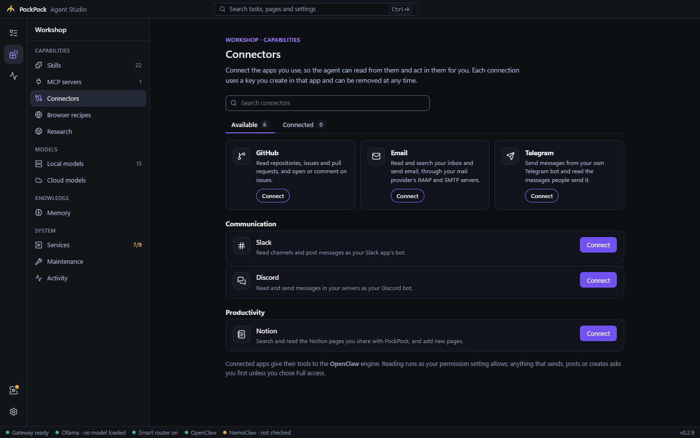
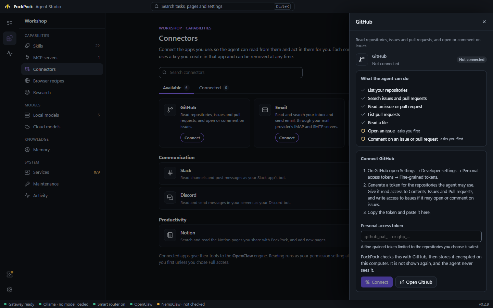
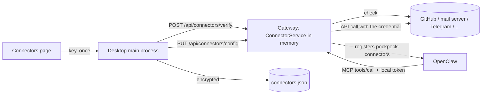

# Connectors

A connector links PockPock to an app outside it, so the agent can read from that app and act in it. The **Connectors** page lists only external apps. Things that run on the computer or have their own page (Ollama, OpenClaw, NemoClaw, cloud models, skills, MCP servers) are not connectors and are not shown there.

Every connector is real: the credential is checked with the app before it is saved, and a connected app gives the agent a fixed set of tools.

| Connector | Connects with | The agent can | Asks first |
|---|---|---|---|
| **GitHub** | A personal access token (fine-grained recommended) | List repositories, search issues and pull requests, read an issue or pull request with comments, list pull requests, read a file | Open an issue, comment |
| **Email** | Address and app password over IMAP and SMTP (Gmail, iCloud Mail, Yahoo Mail, Fastmail, or another provider's servers) | List recent mail, search the inbox, read a message | Send an email |
| **Telegram** | A bot token from BotFather | Read the latest messages sent to the bot | Send a message |
| **Slack** | A bot token (`xoxb-…`) | List channels, read a channel | Post a message |
| **Discord** | A bot token | List servers and channels, read a channel | Send a message |
| **Notion** | An internal integration secret | Search shared pages, read a page | Add a page |

Not offered, and why: Outlook.com and Microsoft 365 mail, Google Drive, Google Calendar and similar need an OAuth sign-in through an app registered with that company, which PockPock does not have. They are left out instead of being listed without working.

## User flow

| The Connectors page | A connector's page |
|---|---|
|  |  |

1. Open **Workshop → Connectors**. **Available** lists every connector (featured ones as cards, the rest in groups); **Connected** lists the connected ones. **Search connectors** filters by name and description.
2. Press **Connect** on an app. Its page shows what the agent will be able to do (actions that change something are marked **asks you first**), the steps to create the key in that app, and the form. **Open <app>** opens the app's key page in the browser.
3. Enter the key and press **Connect**. PockPock checks it with the app. A refused key is not saved, and the reason is shown.
4. The page then shows **Connected as <account>**. From now on the agent has the app's tools.
5. **Replace key** stores a new key. **Disconnect** deletes the key from the computer and takes the tools away.

## Using a connector in a chat

Connected apps give their tools to the **OpenClaw** engine. Ask in plain words, for example "list the open issues in owner/repo" or "send a Telegram message to the chat that just wrote to my bot".

Tool calls follow the chat's permission setting, like every other OpenClaw tool:

| Permission | Reading tools | Tools that send, post or create |
|---|---|---|
| Ask first | Ask each time | Ask each time |
| Auto | Ask each time (they reach outside the computer) | Ask each time |
| Full access | Run | Run |

The approval card shows the tool and its inputs (recipient, text, repository).

## Modules and data flow

| Path | Role |
|---|---|
| `backend/projects/connectors/catalog.py` | The catalog: each connector's form fields, connect steps and tools with their input schemas |
| `backend/projects/connectors/clients.py` | The credential check and tool calls for each app. HTTP apps use fixed addresses; email uses `imaplib` and `smtplib` over TLS |
| `backend/projects/connectors/service.py` | `ConnectorService`: validates credentials, holds the connected apps in memory, lists tools, runs a tool call |
| `backend/projects/connectors/api.py` | Gateway routes and the MCP endpoint |
| `backend/projects/connectors/openclaw.py` | Registers or removes the MCP server `pockpock-connectors` in OpenClaw |
| `desktop/electron/connectors.cjs` | `Connectors`: the encrypted credential store, connect and disconnect, the push to the gateway |
| `desktop/src/pages/ConnectorsPage.tsx` | The Connectors page and each connector's page |

1. **Connect.** The page sends the form values to the main process (`connectors:connect`). The main process asks the gateway to check them (`POST /api/connectors/verify`, internal token). The gateway validates the fields against the catalog, calls the app (GitHub `GET /user`, Telegram `getMe`, Slack `auth.test`, Discord `GET /users/@me`, Notion `GET /users/me`, an IMAP sign-in for email) and returns the account name. Nothing is stored by the gateway at this point.
2. **Store.** The main process encrypts the credentials with Electron `safeStorage` (DPAPI on Windows, the Keychain on macOS) and writes them to `<userData>/connectors.json` with the account name and time. They are never returned to the page; `connectors:list` carries only the account name. If `safeStorage` is unavailable nothing is saved.
3. **Gateway.** The main process sends the connected apps to `PUT /api/connectors/config` (internal token). The gateway keeps them in memory only, so they are sent again whenever the gateway starts; once a minute the main process compares the gateway's connected count with its own and re-sends after a gateway restart.
4. **Tools.** `POST /mcp/connectors` is a Model Context Protocol server (streamable HTTP with JSON answers; methods `initialize`, `ping`, `tools/list`, `tools/call`). It lists the tools of the connected apps only and needs the *local tool token* (generated once, in `connectors.json`) as a bearer token. A tool call names a tool and its inputs; the gateway adds the credential and calls the app. The agent never sees a credential.
5. **OpenClaw.** After every configuration push the gateway adds, updates or removes the MCP server `pockpock-connectors` in OpenClaw (`mcp.servers`, through `agent_extensions/gateway_config.mjs`): address `http://127.0.0.1:<gateway port>/mcp/connectors`, header `Authorization: Bearer <local tool token>`. It is written only when something differs and removed when no app is connected. It is hidden from the **MCP servers** page, because it is managed here.

## API contract

- `GET /api/connectors`: `{ connectors: [{ id, name, group, about, featured, fields, steps, key_url, tools: [{ name, title, write }], connected, account }] }`. No credentials.
- `POST /api/connectors/verify` (header `X-PockPock-Internal-Token`): `{ id, credentials }` → `{ id, account, credentials }` with the cleaned credentials. `400` for a missing or malformed field, `404` for an unknown connector, `409` when the app refuses the credential, `502` when the app cannot be reached.
- `PUT /api/connectors/config` (internal token): `{ connected: [{ id, account, credentials }], tool_token }`. Replaces everything. `422` for an unknown connector or malformed credentials.
- `POST /mcp/connectors` (header `Authorization: Bearer <local tool token>`): JSON-RPC 2.0. `401` without the token. A failed tool call is returned as a tool result with `isError: true` and a message the model can act on; an unknown tool is JSON-RPC error `-32602`; an unknown method `-32601`. `GET` answers `405`.

Tool names are `<connector>_<action>` (22 in total). Each has a JSON Schema with `additionalProperties: false`; write tools carry `readOnlyHint: false`.

## Security and privacy

- **Credentials** are encrypted at rest by the operating system, held in memory by the gateway, and used only for calls to the connector's own app. They are never sent to the page, the model, a log or an error message (Telegram's token is part of its API address, so errors never include the address).
- **Addresses are fixed.** Every HTTP connector calls only its app's API host. The one user-set address is the email connector's custom mail servers, which must be host names (no IP addresses, ports or URLs) and are always reached over TLS on ports 993 and 465.
- **Inputs from the model are validated** before they reach an app: repository names, channel and page ids, message ids and email addresses match strict patterns; file paths cannot contain `..`; unknown inputs are refused; email subjects cannot carry extra header lines; Discord messages cannot ping `@everyone`.
- **Data leaves the computer** only to the connected app, and what the agent reads from an app goes to the model that runs the chat. With a local model it stays on the computer; with a cloud model it is sent to that provider, like the rest of the chat.
- **Text read from an app is untrusted.** An email or issue can contain instructions aimed at the agent. Sending, posting and creating therefore ask for approval unless Full access is chosen.
- The local tool token only opens the connector tools on loopback; it is not an app credential.

## Failure states

- Refused key, missing form field, app unreachable: shown on the connector's page at connect time; nothing is saved.
- The backend is not running, or is an older version without connectors: the page says so, with **Try again**.
- The saved key cannot be decrypted (files copied to another computer or user account): the connector shows **Reconnect needed**.
- A key is revoked or expires later: the next tool call fails with "the saved credential was refused; reconnect it on the Connectors page".
- The app limits requests, lacks a permission (for example a Slack scope or a GitHub repository permission), or the bot is not in the channel: the tool result says what to change.
- OpenClaw is not installed or not running: the connection is still saved; the tools are registered the next time the configuration is pushed while OpenClaw is up.

## Limits

- The tools reach **OpenClaw** only. PockPock Agent and NemoClaw do not have them yet.
- Email reads the inbox only, sends plain text only, and does not handle attachments. Outlook.com and Microsoft 365 are not supported.
- Telegram, Slack and Discord act as a bot you create, not as your personal account.
- One account per connector.

## Verification

- `python -m unittest projects.connectors.test_connectors` in `backend/` (10 tests): the catalog holds only external apps and every tool has a handler; credential validation; each app's check and tools against a recorded stand-in; input validation; no credential in errors or listings; OpenClaw registration; and the routes over a real socket, with PockPock's own MCP client listing the tools.
- `npm test` in `desktop/` (`connectors.test.cjs`, 4 tests): a refused credential is not saved, an accepted one is stored encrypted and never listed, disconnect, an undecryptable credential, and the error messages.
- Checked on 2026-11-16: a made-up credential is refused by the real GitHub, Telegram, Slack, Discord, Notion and Gmail; and the whole flow in the real app window against an isolated gateway (30 checks: list, search, tabs, GitHub and Gmail refusals from the real services, connect with a stand-in GitHub account, encrypted storage, tools over MCP, disconnect, 1440 and 820 px).
- **Not verified yet:** a connection with a real account on any app; a real tool call against a real account; a real OpenClaw chat using the tools, including the approval card; macOS.
