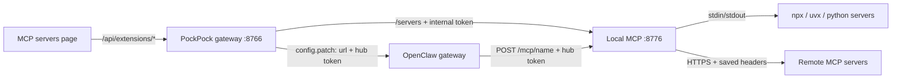

# Local MCP

**Local MCP** is a PockPock service that runs the MCP servers you add, once, on this PC, and offers each of them to the agents at a local address. It replaces the earlier arrangement in which OpenClaw started every server itself and kept their keys in its own configuration.

It is step 1 of the local MCP plan:

| Step | What | State |
|---|---|---|
| 1 | The hub service; servers added in PockPock run in it; existing ones are moved into it; OpenClaw reaches them through it | Done (this page) |
| 2 | PockPock Agent gets the hub's MCP tools and installed skills, through its tool retrieval and approvals (read-only tools run without asking in the default mode; tools that change things, or are not marked, ask) | Planned |
| 3 | Smarter use: example requests written at install time for retrieval, skills loaded only when chosen, slimmer tool definitions for small models, the step planner told what is installed, learning from which tools work, `agent_eval` tasks | Planned |
| 4 | NemoClaw reaches the hub from its sandbox | Planned; depends on the sandbox reaching the PC, not yet verified |

## What the user sees

- **Services** lists **Local MCP** (group Backend, port 8776). It starts with the other backend services, and **Stop**, **Restart** and the log work as for any service. Stopping it stops every server it runs.
- **Workshop → MCP servers** marks each server added in PockPock as *Runs on this PC in Local MCP* (or *Remote server, reached through Local MCP*) and shows its state:

  | Badge | Meaning |
  |---|---|
  | Running · N tools | Started; N tools listed |
  | Starts when used | Saved; started when an agent first connects |
  | Error | It could not start or it stopped; the reason is shown under the server |
  | Local MCP stopped | The Local MCP service is not running |

  Each such server has **Log** (the last 200 lines the server printed since Local MCP started it, kept in memory only) and **Restart** (starts it again now and shows whether it starts). The page says when Local MCP is not running: servers added in PockPock then cannot be used or added.
- Adding, switching and disconnecting work as before ([Agent engines, skills, and MCP servers](agent-extensions.md)): the preview and the test connection are unchanged, and **Connect** now saves the server in Local MCP. A server added outside PockPock, and a server using the older SSE transport, stay in OpenClaw's configuration as before.

## How it works

1. **Adding a server.** The gateway tests the server as before (`mcp_probe.py`), then saves it in Local MCP (`PUT /servers/<name>`: command, arguments, environment values, or address and headers). Local MCP returns the *client entry*: `{url: "http://127.0.0.1:8776/mcp/<name>", transport: "streamable-http", headers: {Authorization: "Bearer <hub token>"}}`. The gateway writes that entry, not the command or keys, into OpenClaw's `mcp.servers.<name>`. If OpenClaw refuses the entry (for example a server of the same name that PockPock did not add), the server is removed from Local MCP again.
2. **Running.** Nothing starts until a client connects. On the first request Local MCP starts the server (stdio), runs the MCP handshake and lists its tools; the process then stays up and serves every client. Each client request gets a hub-side request id, so several clients and calls share one process at once. A server that stops is started again on the next request; one that stopped three times within a minute is held until **Restart** (or a minute passes). Remote servers are posted to with the saved headers; the hub keeps one MCP session and opens a new one when the server forgets it.
3. **What the hub answers itself.** `initialize` (with the server's own capabilities, server info and instructions, in the protocol version the client asked for), `ping`, and, from the server to its client, `ping` and `roots/list` (no roots: servers get their folders from their arguments). Server requests for sampling or elicitation are refused, because the hub has no model or user to ask. Replies are single JSON responses; change notifications are not passed on, so the hub reports `listChanged: false` and a changed tool list is picked up on the next `tools/list`.
4. **Moving existing servers.** At every gateway start a background task (`sync_local_mcp_loop` in `pockpock_server.py`, retried every 30 s for about ten minutes while Local MCP or OpenClaw is still starting) runs `ExtensionService.sync_local_mcp()`:
   - a server PockPock installed before Local MCP (stdio or streamable HTTP) is read from OpenClaw's configuration **file** (OpenClaw's gateway shows secret values as `__OPENCLAW_REDACTED__`, so they are read from the file it writes), saved in Local MCP with its keys and its on/off switch, and OpenClaw's entry is replaced by the client entry. A server whose keys can only be read as that placeholder is left as it is and reported, never saved with the placeholder;
   - a server already in Local MCP whose OpenClaw entry no longer matches (another port or token) is pointed at the hub again;
   - a server left in Local MCP after PockPock removed it (while Local MCP was stopped) is removed.
   Servers added outside PockPock, and SSE servers, are not touched.
5. **Switching and removing.** A switch turns the server off in Local MCP too: it is stopped and refused to every client, not only hidden from OpenClaw. Removing deletes it from OpenClaw, Local MCP and PockPock's manifest.
6. **Permissions.** Unchanged for OpenClaw: every MCP tool call still passes the OpenClaw permission plugin (`Use MCP tool: <server> › <tool>`). OpenClaw's per-turn tool retrieval (`openclaw_bridge/tool_selection.py`) still ranks servers by name and by what they run: the listing gives the server's real command or address, not the hub's.

## Modules

| Path | Role |
|---|---|
| `backend/projects/mcp_hub/app.py` | The service: `/health`, the management routes, and the MCP endpoint `/mcp/<name>` |
| `backend/projects/mcp_hub/hub.py` | `Hub`: the saved servers, their state, and how each client message is answered or passed on |
| `backend/projects/mcp_hub/upstream.py` | `StdioUpstream` (process, request ids, restarts, log) and `HttpUpstream` (remote server, MCP session) |
| `backend/projects/mcp_hub/store.py` | `servers.json`: definitions with sealed secrets, and the hub token |
| `backend/projects/mcp_hub/protect.py` | Seals secrets: DPAPI on Windows; base64 in a user-only file elsewhere |
| `backend/projects/mcp_hub/fake_server.py`, `test_hub.py` | A stand-in stdio server and the hub's tests |
| `backend/projects/agent_extensions/hub_client.py` | The gateway's client for the management routes |
| `backend/projects/agent_extensions/service.py` | Install into Local MCP, list with state, switch, remove, `restart_mcp`, `mcp_log`, `sync_local_mcp` |
| `backend/projects/agent_extensions/gateway_config.mjs` | `mcp_export`: one server's full definition from OpenClaw's config file, used only to move it |
| `desktop/electron/services.cjs` | The `mcp-hub` service (started with the backend services; stopped before an update installs) |
| `desktop/src/pages/McpPage.tsx` | State badges, **Log**, **Restart**, the "Local MCP is not running" note |

## Contracts

Management (gateway only; header `X-PockPock-Internal-Token`):

| Route | Body | Result |
|---|---|---|
| `GET /servers` | – | `{servers: [{name, transport, target, source, enabled, env_keys, has_headers, state, detail, tools, started_at, calls, failures}]}`; `state` is `stopped`, `starting`, `running`, `error` or `off`. Never a secret value |
| `PUT /servers/{name}` | `{transport: "stdio"\|"streamable-http", command, args, env, url, headers, enabled, source}` | `{server, client}`; `400` for an invalid definition. A changed command, arguments, keys or address restarts the server on next use |
| `DELETE /servers/{name}` | – | `{removed}` |
| `POST /servers/{name}/enabled` | `{enabled}` | `{server}` |
| `POST /servers/{name}/restart` | – | `{server}` after trying to start it (up to about 150 s for a first `npx`/`uvx` download) |
| `GET /servers/{name}/log` | – | `{lines}` |
| `GET /servers/{name}/client` | – | `{client}` |

Clients (header `Authorization: Bearer <hub token>`): `POST /mcp/{name}` takes one JSON-RPC 2.0 message and answers with one JSON reply (`202` for a notification); `GET` answers `405`; `DELETE` answers `204`. Errors: `-32002` no such server; a tool call that cannot run (server off, not starting, crashed, keys unreadable) comes back as a tool result with `isError: true` and the reason, so the model can read it; other failures are `-32603` with the reason; the server's own JSON-RPC errors are passed on unchanged.

Gateway (from this PC only, as the other extension routes): `POST /api/extensions/mcp/restart {name}` → `{server}`; `GET /api/extensions/mcp/log?name=` → `{lines}`; `GET /api/extensions` adds `local, state, state_detail, tools` to each server and `local_mcp: {running, detail}`.

## Persistence and secrets

- `<PockPock data>/mcp-hub/servers.json` (Windows: `%LOCALAPPDATA%\PockPock\mcp-hub\`; `POCKPOCK_MCP_HUB_DIR` overrides): each server's definition, with environment values and headers sealed; the hub token. Written atomically, readable only by the user where the system allows.
- **Windows:** secrets are encrypted with DPAPI for the current user, so the file is useless to another user or on another PC. **macOS and Linux:** there is no dependency-free equivalent yet; secrets are stored base64-encoded in that user-only file, which is the same protection OpenClaw's own configuration gave them before. (`protect.protected()` says which applies.)
- A server whose saved secrets cannot be read (the file was copied to another PC) shows **Error**: "Its saved keys cannot be read on this PC. Connect it again."
- OpenClaw's `mcp.servers.<name>` holds only the hub address and the hub token, a local token like the connector tool token, never a third-party key.
- `~/.openclaw/pockpock/extensions.json` marks a server in Local MCP with `"hub": true`.
- Logs are kept in memory (200 lines per server) and lost when Local MCP stops. A server may print its own secrets; PockPock does not write them anywhere else.

## Configuration

| Variable | Default | Used by |
|---|---|---|
| `POCKPOCK_MCP_HUB_PORT` | `8776` | Local MCP's port (also in the client entries it hands out) |
| `POCKPOCK_MCP_HUB_URL` | `http://127.0.0.1:8776` | The gateway, to reach Local MCP |
| `POCKPOCK_MCP_HUB_DIR` | `<PockPock data>/mcp-hub` | Where Local MCP keeps its file |
| `POCKPOCK_MCP_HUB_SYNC` | `1` | `0` turns off the move and re-pointing at gateway start (used for isolated test gateways) |

## Failure states

| What you see | Cause | What to do |
|---|---|---|
| "Local MCP is not running. Start it on the Services page, then try again." (adding a server, or the MCP page note) | The service is stopped | Start **Local MCP** on **Services** |
| **Error** with "`npx` is not installed on this PC" | The launcher is missing | Install it, then **Restart** |
| **Error** "It did not start: …" or "The server stopped (exit code N). Last output: …" | Wrong arguments or key, or the package failed | Check **Log**; fix it by connecting the server again with new settings |
| A tool call answers "The server stopped 3 times in a minute" | The server keeps crashing | Fix the cause, then **Restart** |
| **Error** "Its saved keys cannot be read on this PC" | The data was copied from another PC or user | Connect the server again |
| A remote server: "The server refused the saved key or sign-in" | The saved Authorization value is no longer valid | Connect it again with a new value |
| OpenClaw reports the server unavailable | Local MCP stopped, or the hub token changed while the gateway was not running | Start Local MCP; the gateway points OpenClaw at it again at its next start |
| A server PockPock installed earlier is still started by OpenClaw | Its keys could only be read hidden, or OpenClaw or Local MCP was not running during the ten minutes after the gateway started | Restart the gateway with both running; if it stays, connect the server again |

## Limits

- Only OpenClaw uses Local MCP so far (steps 2 and 4 above).
- No server-to-client streaming: progress and log notifications from servers are not passed on, and server requests for sampling or elicitation are refused.
- Servers using the older SSE transport, and servers added outside PockPock, are still run by OpenClaw.
- Secrets are encrypted at rest on Windows only.
- A new hub token (Local MCP's data folder deleted) also loses the saved servers; they are reported in the gateway log as lost and must be connected again.

## Verification

- `backend/scripts/run_tests.py` runs `projects.mcp_hub.test_hub` (tokens; a client session through the hub; requests from the server answered by the hub; one process shared by concurrent calls; restart after a crash and the hold after three; switching off, changing and removing; a missing launcher; a remote server reached through a second hub; sealed secrets; unreadable secrets; definition checks) and `projects.agent_extensions.test_extensions` (install into Local MCP, rollback on conflict, listing with state, switch, restart, log, remove, the move of earlier servers with their switches, re-pointing after a token change, orphans, keys shown only hidden, Local MCP not running).
- Live checks on 2026-11-22 (Windows, hub from source on a test port with a temporary data folder; the user's own OpenClaw and data untouched):
  - `@modelcontextprotocol/server-filesystem` (via `npx`) and `@playwright/mcp` ran in the hub: handshake in 3.3 s and 1.0 s, 16 and 25 tools, a real file read, the server's own folder limit still enforced, six concurrent calls on one process.
  - OpenClaw's own MCP client (`openclaw mcp probe`, with a temporary OpenClaw configuration) listed both servers' tools through the hub, and was refused with a wrong token.
  - The move, against a real OpenClaw gateway on a temporary configuration: PockPock's two servers moved, OpenClaw's entries replaced by the hub address, the made-up key gone from OpenClaw's file and present (DPAPI-sealed, real value) in Local MCP, the off switch kept, a server PockPock did not add untouched, a second run a no-op, OpenClaw reaching both moved servers, and removal deleting from both.
  - Stopping the hub by process tree, as the app does, left no server process running.
- **Not verified yet:** a full OpenClaw chat turn that calls a hub tool; macOS and Linux (CI runs the tests there).
