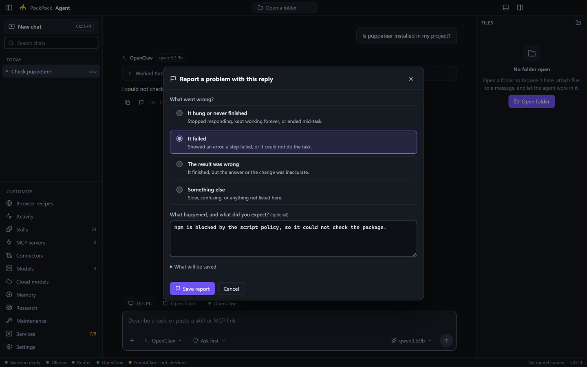
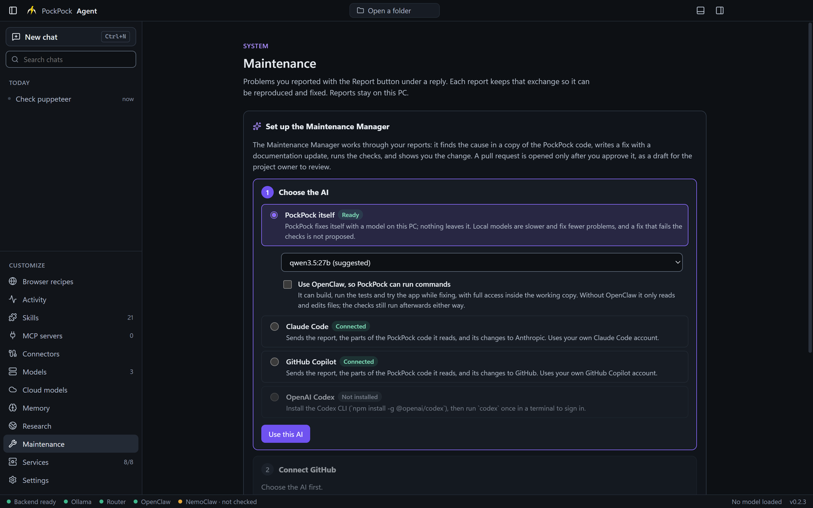

# Problem reports and Maintenance

Users report a reply that hung, failed or was wrong with the **Report** button under it. Reports stay on the PC and are listed on the **Maintenance** page, where they can be reviewed, corrected or deleted. The **Maintenance Manager** on the same page works through them: with an AI the user chooses, it finds the cause in its own copy of the PockPock code, fixes it together with a documentation update, runs the checks, and, only after the user approves, opens a **draft** pull request for the project owner, who reviews open pull requests weekly and merges or rejects them.

## User flow

1. Under any assistant reply, press **Report** (the flag button next to **Copy reply**).
2. Choose what went wrong: **It hung or never finished**, **It failed**, **The result was wrong**, or **Something else**. A stopped reply starts on "hung", an error reply on "failed".
3. Optionally describe what happened and what you expected.
4. **What will be saved** shows the exact captured exchange after redaction, and what was hidden (for example "2 folder paths").
5. **Save report**. The dialog confirms and offers **Open Maintenance**.
6. **Maintenance** (sidebar) lists reports, newest first, with their category, status, chat, mode and age. Open one to change its category, status (**Open**, **Being fixed**, **Fixed**, **Won't fix**) or description, read the full capture, or delete it.

## Maintenance Manager

### Setup (once)

**Maintenance → Set up the Maintenance Manager** has three steps; each needs an explicit click and can be changed later (**Change setup**).

1. **Choose the AI.** PockPock lists what it finds on the PC:

   | AI | Detected as | Data |
   |---|---|---|
   | **PockPock itself** | At least one Ollama model; the largest is suggested | Stays on the PC. Slower, and fixes fewer problems. Option **Use OpenClaw, so PockPock can run commands** (needs OpenClaw): off, it uses PockPock's own file-only agent; on, it works through OpenClaw and can build, run the tests and try the app while fixing |
   | Claude Code | `claude` CLI, signed in | The report, the code it reads and its changes go to Anthropic, under the user's account; needs a Claude subscription or API account |
   | GitHub Copilot | `copilot` CLI, signed in | Same, to GitHub; needs a Copilot subscription |
   | OpenAI Codex | `codex` CLI | Same, to OpenAI |

   **Connecting Claude Code or GitHub Copilot.** Each of the two shows one of three states: **Connected** (installed and signed in; can be chosen), **Not signed in**, or **Not installed**. The button under it (**Install and connect …** or **Sign in to …**) does what is missing, and nothing is installed before it is pressed (`connectAgent` in `desktop/electron/maintenance.cjs`, helpers in `maintenance-connect.cjs`):

   1. *Install*, when the CLI is missing: winget on Windows (`Anthropic.ClaudeCode`, `GitHub.Copilot`) or Homebrew on macOS (`claude-code` cask, `copilot-cli`), then `npm install -g` (`@anthropic-ai/claude-code`, `@github/copilot`) as the fallback. Progress lines are shown under the button. winget installs Claude Code as a portable package in `%LOCALAPPDATA%\Microsoft\WinGet\Packages\Anthropic.ClaudeCode_…`, which PockPock searches directly, because a running app does not see the PATH entry winget adds.
   2. *Sign in*, when needed: `claude auth login` or `copilot login`, the tool's own browser sign-in. A link the tool prints is offered as **Open sign-in page** in case the browser did not open. PockPock never sees or stores a token; each tool keeps its own credentials. **Cancel** stops either step.

   Signed-in checks: Claude Code through `claude auth status` (it is already signed in when Claude Code is used elsewhere on the PC, for example in VS Code); the Copilot CLI has no status command, so it counts as signed in after `copilot login` from here, or when the GitHub CLI is signed in (Copilot uses its token) or a `GH_TOKEN`/`COPILOT_GITHUB_TOKEN` variable is set. The time of a successful connection is kept as `connected` in `maintenance.json`. OpenAI Codex is detected but not installed from the app; its row says how to install it.
2. **Connect GitHub** through the GitHub CLI (`gh auth login --web`): the app shows the one-time code and opens github.com/login/device. PockPock then checks whether the account can push to `PockPock9/PockPockAgent`.
3. **Copy of PockPock.** The user picks a folder (default `Documents/PockPock/PockPockAgent`) and presses **Allow and clone**. Accounts without push rights get a fork in their own GitHub account (`gh repo fork`), and the copy is cloned from it. Commits made by the Manager use the account's GitHub no-reply email (`<id>+<login>@users.noreply.github.com`), set in the copy only.

The setup is saved in `<app data>/maintenance.json`. **Change setup** keeps the copy on disk.

### Fixing a report

On a report, **Fix with …** starts a run (`desktop/electron/maintenance-fix.cjs`):

1. Update the copy (`git fetch` from `origin`, or `upstream` for a fork) and create a git worktree on a new branch `fix/report-<id>` from the latest `main`, in a sibling folder `PockPockAgent-fixes/report-<id>`. A previous attempt for the same report is replaced.
2. Give the chosen AI the report (already redacted) and these rules: read `AGENTS.md`; make the smallest correct fix; **update the documentation in the same change**; add or update a focused test; run the checks; do not commit, push or open pull requests; write the PR title and description to `.pockpock-pr.md`. **PockPock itself** runs `desktop/electron/maintenance-agent.cjs`: a tool loop against the chosen Ollama model with six tools (`list_files`, `search`, `read_file`, `replace_in_file`, `write_file`, `finish`) confined to the worktree (no `..`, no `.git`). It cannot run commands, so no tool can hang it; each model call is limited to 6 minutes and the run to 40 steps, and its prompt is small enough for local models (OpenClaw's own prompt is about 21K tokens, which overwhelmed `qwen3.5:9b` and stalled on a hung tool in testing); With **Use OpenClaw** on, PockPock itself instead runs as an OpenClaw turn (`runOpenClaw` in `maintenance-fix.cjs`, through `gateway_turn.mjs`) with Full access and the chosen model, told to work only in the worktree, to start every command with `Set-Location` there, and to build and test the fix (`npm.cmd ci`, `typecheck`, `test`, `build`, Python tests); the run is stopped and marked failed after 10 minutes without a tool call (`idleGuard`, `OPENCLAW_IDLE_MS`), because OpenClaw counts each finished model call as progress and a small model can otherwise loop for half an hour without touching a file (seen with `qwen3.5:9b`: 34 minutes, no changes). The whole run is capped at 45 minutes. A small local model works better with the option off; use OpenClaw with a larger model (27b or more) when the fix needs commands. Claude Code runs with `-p` and edit permission plus a list of allowed check commands; Codex with `exec --full-auto -`; both get the prompt on stdin (`agentCommand`), because npm installs them as `.cmd` launchers that only run through `cmd.exe`, where Node does not escape arguments, so report text must never be part of that command line; Copilot with `-p --allow-all-tools` and `git push`, `git commit`, `git reset` and `gh` denied.
3. The Manager checks the result itself:
   - nothing changed: not proposed (the AI's notes are shown);
   - no documentation change (`docs/`, any `README.md` or other `.md`): not proposed, because every fix needs one;
   - then the checks for what changed: desktop code runs `npm ci`, `npm run typecheck`, `npm test` and `npm run build` in `desktop/`; Python code runs `backend/scripts/run_tests.py` with PockPock's Python; OpenClaw bridge changes run its node tests. A failing check stops the run with its output.
4. The report's status becomes **Being fixed**; the page shows the live log, then either the reason it was not proposed (**Try again**, **Discard**) or the fix ready for review.

### Automatic mode

**Keep fixing reports automatically** (in the set-up summary) lets PockPock work through reports on its own: when nothing is running, it starts on the oldest **Open** report that has no fix attempt yet. It checks one minute after the app starts, when a report is saved, and after every run. One report runs at a time; a report whose fix failed is not retried automatically (press **Try again**), so a problem the AI cannot fix does not loop. Automatic mode only prepares fixes: each still waits for the user's **Approve and open draft PR**. The setting is `auto` in `maintenance.json`.

### Reviewing and approving

A fix ready for review shows the changed files, the diff, the checks that passed, and an editable PR title and description. **Approve and open draft PR** commits the change, pushes the branch (to the fork for accounts without push rights) and runs `gh pr create --draft` against `PockPock9/PockPockAgent`; the description is redacted again and ends with a note of the AI, the checks and that the reporter approved it. **Discard fix** removes the worktree and the branch. The Manager never merges.

## What a report contains

| Field | Content |
|---|---|
| `category`, `description`, `status` | The user's choice and text (max 4,000 characters), status starts `open` |
| `capture.appVersion`, `platform`, `engine`, `model`, `chatTitle`, `createdAt` | Where it happened |
| `capture.userMessage`, `attachments` | The user message before the reply; attachment **names only**, never contents |
| `capture.reply`, `status`, `notice` | The reply text and its outcome |
| `capture.plan` | PockPock Agent plan goal, steps and decision |
| `capture.steps` | Each step's label, status, error detail and duration |
| `capture.approvals` | Each approval's title, description (command, path or URL) and outcome |
| `capture.timing` | The Thinking/Planning/Waiting/Working/Total breakdown |
| `redactions` | How many folder paths, user names, email addresses and keys or tokens were hidden |

Strings are capped (20,000 characters each, 120 steps, 60 approvals); unknown fields are dropped.

## Privacy

- Reports never leave the PC. They are stored as one JSON file each in `<app data>/reports/` (`%APPDATA%\PockPock Agent\reports` on Windows, `~/Library/Application Support/PockPock Agent/reports` on macOS), at most 200 (the oldest are removed).
- Before storing, the main process redacts every string in the capture and the description: the user's home folder in any slash style becomes `~`, the user name `<user>`, email addresses `<email>`, and API keys, tokens, `password=`/`token=` values and long opaque strings `<secret>`. The dialog shows the redacted capture before saving.
- Redaction is pattern-based. It cannot recognise every personal detail in free text (a name or address typed into a prompt), so the preview is there for the user to check.

## Modules and contract

| Module | Role |
|---|---|
| `desktop/src/lib/reports.ts` | `buildCapture` (one reply and the user message before it), labels, `captureText`, `describeRedactions` |
| `desktop/src/components/ReportDialog.tsx` | The dialog: modal, focus kept inside, Escape closes, buttons always visible |
| `desktop/src/pages/MaintenancePage.tsx` | List and detail views |
| `desktop/electron/reports.cjs` | `ReportStore` (validate, redact, store, prune), `prepareCapture`, `redactText`; unit tests in `reports.test.cjs` |
| `desktop/electron/maintenance.cjs` | Setup: AI detection, GitHub status and sign-in, clone or fork; tests in `maintenance.test.cjs` |
| `desktop/electron/maintenance-fix.cjs` | Fix runs, automatic mode, checks, approval and discard; tests in `maintenance-fix.test.cjs` |
| `desktop/electron/maintenance-connect.cjs` | Connect for Claude Code and GitHub Copilot: install plan (winget or Homebrew, then npm), sign-in commands, CLI output handling; tests in `maintenance.test.cjs` |
| `desktop/electron/maintenance-agent.cjs` | "PockPock itself": the local tool loop and its worktree-confined tools; tests in `maintenance-agent.test.cjs` |
| `desktop/src/components/MaintenanceSetup.tsx`, `FixPanel.tsx` | The setup steps and the per-report fix panel |

IPC (preload `window.pockpock.reports`, all registered with `handle()`): `preview(capture)` returns the redacted capture and counts without saving; `create({ category, description, capture })`; `list()` (without captures); `get(id)`; `update(id, { category?, status?, description? })`; `delete(id)`. Ids must match `r-<base36>-<8 hex>`, so a renderer cannot read or delete other files; categories and statuses are checked against fixed lists.

## Failure states

- The capture cannot be built (for example the app info call fails): the dialog shows the error and Save stays disabled.
- Saving fails (disk full, permissions): the error is shown and the form keeps what was typed.
- A report file is unreadable: it is skipped in the list; opening a missing id shows "Unknown report."
- Maintenance Manager: the GitHub CLI or Git is missing (setup says how to install it); sign-in is cancelled or fails (the error is shown, **Connect GitHub** can be pressed again); the clone folder is not empty and not a PockPock copy (refused); fetching, creating the worktree, the AI, a check, the commit, the push or `gh pr create` fails (the run stops with the reason and output; nothing is pushed unless the push itself succeeded). The AI is stopped after 45 minutes and each check after 20.
- Connect fails: neither winget/Homebrew nor npm is available (run Setup first), the install does not produce the CLI, or the sign-in is cancelled or times out after 10 minutes. The reason is shown under the button with the tool's own output, and the button can be pressed again; signing in from a terminal (`claude` or `copilot login`) and pressing **Check again** also works.
- A cloud AI stops part-way (for example Claude Code's "You've hit your 5-hour limit") after it already changed files: the run still goes through the documentation requirement and the checks, and when they pass it is shown as ready with a red warning that quotes the tool's last line and says the change may be incomplete (`warning` on the run, from `stoppedEarlyWarning`). The PR title falls back to a generic one when the AI did not write `.pockpock-pr.md`; edit it before approving, or discard and try again later.
- A cloud AI refuses the request, for example Copilot's "You have exceeded your monthly quota": the run fails with "The AI stopped with an error" and the CLI's message in the log, and the worktree is removed when the attempt is discarded. Choose another AI in setup or wait for the quota to reset, then press **Try again**. (Copilot also logs that it skipped the repo's `.mcp.json` because the worktree folder is not trusted; that is expected and harmless.)

## Verification

- `npm test` in `desktop/`: reports (redaction, capture sanitising, store create/list/update/delete, id checks), Maintenance Manager setup (`maintenance.test.cjs`: device-code parsing, model suggestion, AI choice validation, folder checks) and fix runs (`maintenance-fix.test.cjs`: documentation paths, check planning, the AI's instructions, PR text).
- In the app with a temporary profile (`POCKPOCK_DESKTOP_USER_DATA`), in PockPock Dark and Feather at 1440 px and 820 px: Report opens with focus inside and closes on Escape; the preview hides the home folder; the stored file contains no home folder, email or attachment contents; status changes persist; delete removes the file; no horizontal overflow or console errors.
