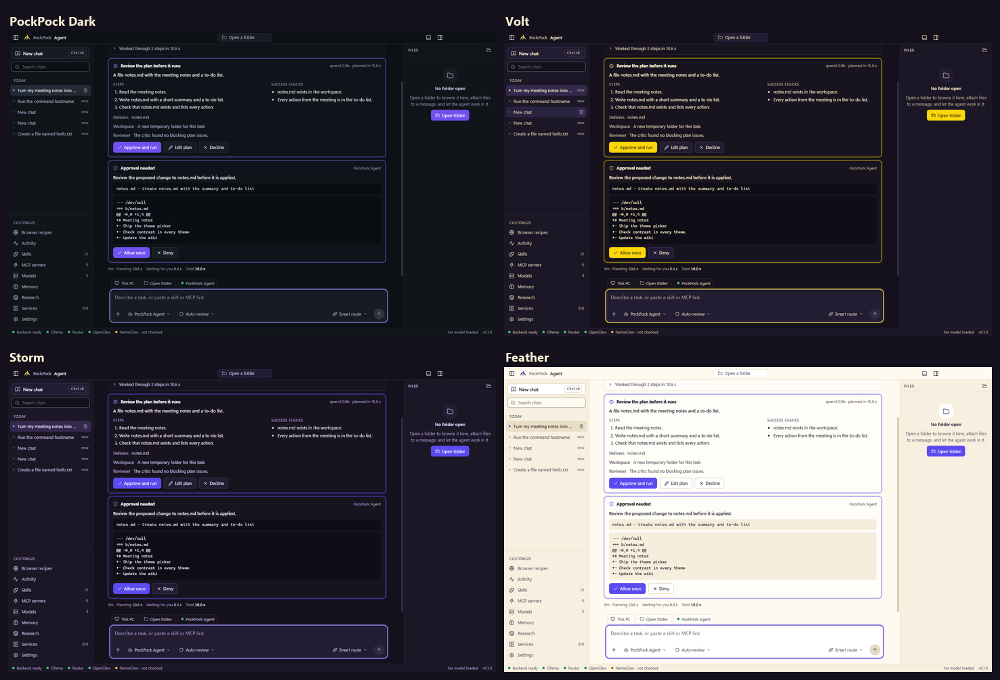
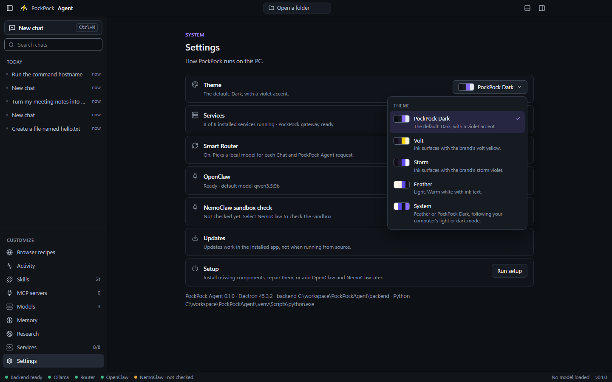

# Themes and the brand mark

The desktop app has five themes and shows the PockPock mark in its title bar and while it works. Colours, contrast results and the steps for adding a theme are in the design system: [`design-system/pockpock-desktop.md`](../../design-system/pockpock-desktop.md#themes).

## What the user sees

- **Settings → Theme** opens a picker with a colour preview per theme: **PockPock Dark** (the default, violet accent), **Volt** (ink with volt yellow), **Storm** (ink with storm violet), **Feather** (light) and **System** (Feather or PockPock Dark, following the computer's light or dark mode, also while the app runs). The choice applies at once and is remembered.
- The app opens in the saved theme with no flash of another theme: the window background, the Windows caption buttons and the page all start in it.
- The title bar shows the mark (a chicken foot whose centre toe is a lightning bolt) next to "PockPock Agent".
- While an agent thinks, plans or runs a tool, the mark's bolt pulses next to the status text ("Thinking", "Planning and reviewing the task", the running step) and its elapsed time, and a thin bar sweeps along the top of the composer. With **reduce motion** switched on in the operating system, nothing moves: the bolt is still, the bar is solid, and the text stays.

## Modules

| Module | Role |
|---|---|
| `desktop/src/styles.css` | All colour tokens: `:root` (PockPock Dark) and one `:root[data-theme="…"]` block per other theme. Components use only tokens. |
| `desktop/src/lib/theme.ts` | Theme list and previews, `useTheme` (applies the setting, follows the OS for System, tells the main process), terminal colours per theme. |
| `desktop/public/theme-boot.js` | Runs in `<head>` before the app: sets `data-theme` from `?theme=`. A separate file because the page's Content-Security-Policy allows no inline script. |
| `desktop/electron/themes.cjs` | Allowed theme ids, window background and caption-button colour per theme, resolving "system", setting `nativeTheme.themeSource`. |
| `desktop/electron/main.cjs` | Applies the saved theme to the new window and its URL; the `theme:set` handler; follows OS changes for System. |
| `desktop/src/components/Mark.tsx` | The mark as inline SVG with themed colours; `working` makes the bolt pulse. |
| `desktop/src/pages/Pages.tsx` | The Theme row and picker on the Settings page. |
| `desktop/src/components/TerminalPanel.tsx` | Re-colours xterm when the theme changes. |
| `desktop/scripts/check_contrast.mjs` | `npm run check:contrast`: WCAG AA checks for every theme. |

## Data and control flow

1. **Start.** `main.cjs` reads `theme` from `settings.json` (an unknown value falls back to `pockpock-dark`), sets `nativeTheme.themeSource` (`dark`, `light`, or `system`), resolves "system" with `nativeTheme.shouldUseDarkColors`, creates the window with that theme's background and title-bar overlay colours, and loads `/?theme=<resolved id>`.
2. **First paint.** `theme-boot.js` sets `<html data-theme>` from the query, accepting only the four concrete ids.
3. **Settings loaded.** `useTheme(settings.theme, loaded)` sets `data-theme` (resolving "system" with `prefers-color-scheme`), fires `pockpock:theme` on `window`, and calls `window.pockpock.theme.set(id)`.
4. **Main process.** `theme:set` accepts only the five ids (anything else is rejected with "Unknown theme."), updates `nativeTheme.themeSource`, the window background and, on Windows, `setTitleBarOverlay`, and returns the resolved id. The renderer applies its theme again after this, because Chromium's `prefers-color-scheme` follows `themeSource`.
5. **System mode.** The renderer listens for `prefers-color-scheme` changes; the main process listens for `nativeTheme` `updated` and re-colours the window chrome.
6. **Changing theme.** The picker saves `theme` in `settings.json` through the normal settings store; steps 3 to 4 run again.

## Contract

- `window.pockpock.theme.set(id: 'pockpock-dark' | 'volt' | 'storm' | 'feather' | 'system'): Promise<string>`: the resolved theme id. Registered with `handle()`, so it only answers the app's own page.
- Setting: `settings.json` → `"theme": "<id>"`. Missing or unknown means PockPock Dark.
- DOM: `<html data-theme="pockpock-dark|volt|storm|feather">`; `window` event `pockpock:theme` after it changes.

## Accessibility

Every theme meets WCAG 2.2 AA for body text (4.5:1), large text and interface parts such as borders, switches, status dots and the focus ring (3:1), checked for 68 pairs per theme. Status is never shown by colour alone (dots have text, steps have icons and words, the selected theme has a check mark and `aria-checked`). The mark is decorative (`aria-hidden`); the "Thinking" line is a live status region.

## Failure states

- An unknown or corrupted `theme` value falls back to PockPock Dark at start and in the renderer; the main process rejects unknown ids.
- If `theme:set` fails, the page keeps the chosen colours; only the window chrome may lag until the next start.
- Running from source (`npm run dev`), the Vite page gets the same `?theme=`.

## Verification

1. `npm run check:contrast` in `desktop/`: every theme passes every pair.
2. `npm run typecheck` and `npm run build`.
3. In the app: switch each theme in **Settings → Theme**, restart (it opens in the saved theme without a flash), check chat, plan and approval cards, Customize pages, Settings and the terminal at 1440×900 and 820 px.
4. With **System**, switch the operating system between light and dark: the app follows, including the Windows caption buttons.
5. Start a task: the bolt pulses and the composer bar sweeps; with reduced motion on, both stop and the text stays.
